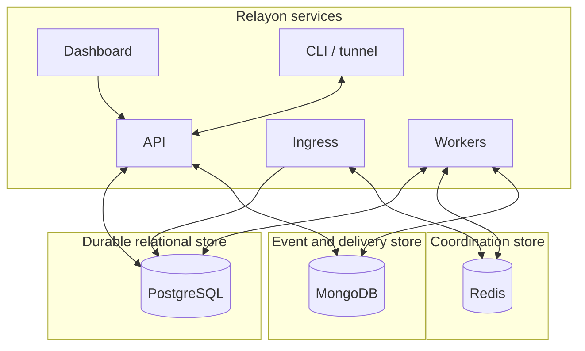
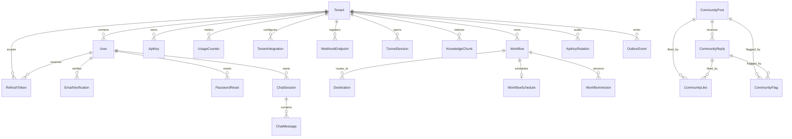
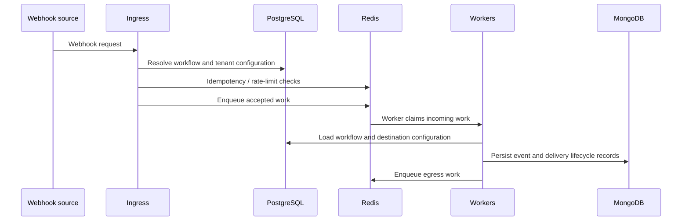
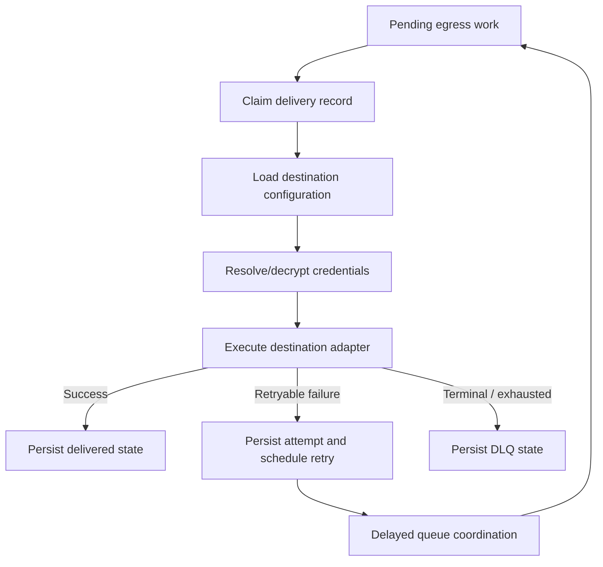

# Relayon — Database Design

> **Engineering reference for Relayon's persistence layer: PostgreSQL, MongoDB and Redis.**
>
> **Documentation target:** v3.7.0  
> **Schema source audited:** `packages/db/prisma/schema.prisma` on `main`  
> **Verified migration history:** through `20261118214615_v35_byok_integrations`

This document describes the data model and persistence responsibilities visible in the repository schema. It distinguishes durable relational state from event/delivery documents and ephemeral coordination state. Where provider plans, retention settings or operational guarantees depend on deployment configuration, they are identified as configuration-dependent rather than universal guarantees.

> **Schema currency note:** The requested documentation target is v3.7.0. The accessible `main`-branch Prisma schema and migration directory expose database additions through v3.5 (BYOK integrations). No v3.6/v3.7 database migration was present in that inspected migration list. Do not infer that later application releases necessarily introduced new database tables.

---

## Contents

- [1. Data architecture](#1-data-architecture)
- [2. Design principles](#2-design-principles)
- [3. PostgreSQL](#3-postgresql)
  - [3.1 Entity relationship overview](#31-entity-relationship-overview)
  - [3.2 Core identity and tenancy](#32-core-identity-and-tenancy)
  - [3.3 Workflow configuration](#33-workflow-configuration)
  - [3.4 Platform operations and metering](#34-platform-operations-and-metering)
  - [3.5 AI and knowledge data](#35-ai-and-knowledge-data)
  - [3.6 Analytics, administration and community](#36-analytics-administration-and-community)
  - [3.7 Webhooks, outbox, flags, tunnels and integrations](#37-webhooks-outbox-flags-tunnels-and-integrations)
  - [3.8 Enums and indexes](#38-enums-and-indexes)
  - [3.9 Row-level security](#39-row-level-security)
- [4. MongoDB](#4-mongodb)
- [5. Redis](#5-redis)
- [6. Cross-store data flows](#6-cross-store-data-flows)
- [7. Migrations and Prisma](#7-migrations-and-prisma)
- [8. Backup, restore and retention](#8-backup-restore-and-retention)
- [9. Operational queries](#9-operational-queries)
- [10. Data ownership and change checklist](#10-data-ownership-and-change-checklist)

---

## 1. Data architecture

Relayon uses three persistence systems with different consistency and lifecycle requirements.

| Store | Primary responsibility | Data characteristics |
|---|---|---|
| **PostgreSQL** | Durable platform state | Relational entities, constraints, transactions, tenant ownership, billing and configuration |
| **MongoDB** | Event and delivery records | Flexible webhook payloads, processing state, delivery attempts and operational history |
| **Redis** | Coordination and short-lived state | Queues, idempotency, rate-limit counters, cache and circuit-breaker state |



The diagram is a responsibility map, not a claim that every service performs every operation. Concrete read/write ownership is described below.

### Consistency boundaries

- PostgreSQL constraints and transactions govern relational records within PostgreSQL.
- MongoDB documents are not protected by PostgreSQL foreign keys. IDs such as `tenantId`, `workflowId`, `eventId` and `destinationId` are cross-store references maintained by application logic.
- Redis does not participate in a distributed transaction with either database.
- A successful write to one store does not imply an atomic commit across all three stores. Retry, idempotency, recovery and reconciliation behavior must be designed at the workflow boundary.

---

## 2. Design principles

1. **PostgreSQL owns durable platform configuration.** Tenant, user, workflow, destination, credential-integration metadata, usage and platform-management records belong here.
2. **MongoDB owns event-processing records.** Webhook event payloads and delivery lifecycle documents are modeled for flexible payloads and operational querying.
3. **Redis coordinates work; it is not the durable business ledger.** Queue and cache state can be rebuilt only where the corresponding source record and recovery path exist.
4. **Cross-store references are conventions, not foreign keys.** Validate tenant ownership and referenced entity state in application code.
5. **Tenant context is a security boundary.** Tenant-scoped reads and writes must consistently carry tenant identity; database RLS is an additional control where a policy exists, not a substitute for application authorization.
6. **Schema is the contract.** The Prisma schema and checked-in SQL migrations take precedence over old diagrams, release notes or copied examples.
7. **Retention is explicit.** TTL cleanup is asynchronous and must not be treated as a precise deletion deadline.
8. **Avoid unsupported guarantees.** Provider backup tiers, Redis durability, MongoDB retention and production RPO/RTO depend on the actual deployed plans and configuration.

---

## 3. PostgreSQL

PostgreSQL is accessed through Prisma. The current schema contains the following model groups.

### 3.1 Entity relationship overview

The diagram below is intentionally a domain-level overview. It omits scalar columns and some optional relations to remain readable.



The schema also contains platform-level records that do not have a direct tenant foreign key, including `PageEvent`, `AdminAuditLog`, `ModerationAction`, `AnnouncementShare` and `FeatureFlag`.

### 3.2 Core identity and tenancy

#### `Tenant` → `tenants`

The tenant is the main ownership boundary for customer data.

| Field | Prisma type | Purpose |
|---|---|---|
| `id` | `String` | UUID primary key |
| `name`, `slug` | `String` | Display identity; slug is unique |
| `plan` | `Plan` | `free`, `pro` or `enterprise` |
| `quotaEventsPerMonth` | `Int` | Event quota |
| `quotaAiTokensPerMonth` | `Int` | AI token quota |
| `quotaMode` | `String` | Quota enforcement mode; default `hard` |
| `currentPeriodStart` | `DateTime` | Current usage/billing period start |
| `stripeCustomerId` | `String?` | Optional Stripe customer reference |
| `stripeSubscriptionId` | `String?` | Optional subscription reference |
| `stripePriceId` | `String?` | Optional price reference |
| `subscriptionStatus` | `String` | Subscription lifecycle marker; default `none` |
| `currentPeriodEnd` | `DateTime?` | Optional period end |
| `createdAt`, `updatedAt` | `DateTime` | Record timestamps |

Relations include users, workflows, refresh tokens, API keys, API-key rotation history, usage counters, chat sessions, knowledge chunks, community posts, outbound webhook endpoints, tunnel sessions and tenant integrations.

#### `User` → `users`

| Field | Purpose |
|---|---|
| `id`, `tenantId` | User identity and tenant association |
| `email` | Globally unique email address |
| `passwordHash` | Nullable to support OAuth-only accounts |
| `name`, `role` | Profile and `UserRole` |
| `emailVerified` | Email verification state |
| `googleId`, `githubId` | Optional unique OAuth provider identifiers |
| `locale` | Preferred locale; default `en` |
| `isSuperAdmin` | Platform-level administrative flag |
| `lastLoginAt` | Last successful login timestamp |
| `createdAt`, `updatedAt` | Record timestamps |

The schema makes `email` unique globally, not as a `(tenantId, email)` pair. A user is associated with one tenant in this schema; do not document multi-tenant membership unless a corresponding model is added.

#### Authentication lifecycle records

| Model | Table | Purpose | Important fields |
|---|---|---|---|
| `RefreshToken` | `refresh_tokens` | Refresh-session tracking | `userId`, `tenantId`, unique `tokenHash`, `expiresAt`, `revokedAt` |
| `EmailVerification` | `email_verifications` | Email ownership verification | `userId`, unique `tokenHash`, `expiresAt`, `usedAt` |
| `PasswordReset` | `password_resets` | Password reset flow | `userId`, unique `tokenHash`, `expiresAt`, `usedAt` |

The schema stores token hashes rather than requiring raw verification/reset tokens to be persisted. Expiry and one-time-use enforcement must also be applied by the service layer.

### 3.3 Workflow configuration

#### `Workflow` → `workflows`

| Field | Purpose |
|---|---|
| `id`, `tenantId` | Identity and tenant ownership |
| `name` | Workflow display name |
| `sourceType` | `SourceType` enum |
| `sourceConfig` | JSON source configuration |
| `enrichmentEnabled` | Whether AI enrichment is enabled |
| `enrichmentPrompt` | Optional custom prompt |
| `transformExpression` | Optional transformation expression |
| `routingRules` | JSON routing-rule collection; default `[]` |
| `isActive` | Workflow activation flag |
| `createdAt`, `updatedAt` | Record timestamps |

`Workflow` relates to its tenant, destinations, optional schedule and version history.

#### `Destination` → `destinations`

| Field | Purpose |
|---|---|
| `id`, `workflowId`, `tenantId` | Identity, workflow and tenant association |
| `type` | `DestinationType` enum in the current Prisma schema |
| `name` | Display name |
| `config` | JSON destination configuration |
| `enabled` | Delivery enablement |
| `retryPolicy` | JSON retry configuration |
| `lastValidatedAt` | Last validation timestamp |
| `lastValidationOk` | Nullable validation result |
| `lastValidationError` | Optional validation error |
| `createdAt`, `updatedAt` | Record timestamps |

**Important correction from the v1.5 document:** The current schema declares `DestinationType` as a Prisma enum. Do not carry forward the old statement that `destinations.type` is a free-form `String`. The enum currently contains `http`, `slack`, `sheets`, `email`, `discord`, `airtable`, `notion`, `postgres` and `mongodb`.

#### `WorkflowSchedule` → `workflow_schedules`

A schedule is optional and one-to-one with a workflow (`workflowId` is unique).

| Field | Purpose |
|---|---|
| `workflowId`, `tenantId` | Workflow and tenant ownership |
| `cronExpression`, `timezone` | Schedule definition |
| `payloadTemplate` | JSON payload template |
| `isActive` | Pause/resume state |
| `lastRunAt`, `nextRunAt` | Execution bookkeeping |
| `createdAt`, `updatedAt` | Record timestamps |

The schema indexes `(isActive, nextRunAt)` and `tenantId`. Schedule claiming and enqueue semantics are application-level behavior; do not treat a due-row query alone as proof that a job was successfully delivered.

#### `WorkflowVersion` → `workflow_versions`

Stores workflow snapshots and a per-workflow version sequence.

| Field | Purpose |
|---|---|
| `workflowId`, `tenantId` | Workflow and tenant ownership |
| `version` | Version number |
| `snapshot` | JSON snapshot |
| `message` | Optional human-readable change label |
| `createdBy` | Optional actor identifier |
| `createdAt` | Creation time |

The schema has a unique constraint on `(workflowId, version)` and an index on `(tenantId, workflowId, version)`.

### 3.4 Platform operations and metering

#### `ApiKey` → `api_keys`

| Field | Purpose |
|---|---|
| `id`, `tenantId`, `name` | Identity, ownership and label |
| `prefix` | Unique lookup prefix |
| `keyHash` | Unique stored key hash |
| `scopes` | String-array permissions |
| `environment` | Environment label; default `live` |
| `lastUsedAt` | Last successful use |
| `expiresAt`, `revokedAt` | Expiry and revocation state |
| `createdAt` | Creation timestamp |

#### `ApiKeyRotation` → `api_key_rotations`

Records rotation lineage/audit metadata: `tenantId`, `oldKeyId`, `newKeyId`, optional `rotatedBy`, `graceUntil` and `createdAt`. The schema indexes `(tenantId, createdAt)`.

#### `UsageCounter` → `usage_counters`

Composite primary key: `(tenantId, period, metric)`.

| Field | Purpose |
|---|---|
| `tenantId` | Tenant owner |
| `period` | Usage period identifier |
| `metric` | Meter name |
| `count` | `BigInt` accumulated value |
| `updatedAt` | Last update |

The composite key prevents multiple counter rows for the same tenant/period/metric tuple. Atomic increment behavior belongs to the service/database operation, not merely the Prisma model declaration.

### 3.5 AI and knowledge data

#### `ChatSession` → `chat_sessions`

Stores a tenant/user-owned chat session with `title`, `createdAt` and `updatedAt`. It relates to `ChatMessage[]` and has an index on `(tenantId, userId, updatedAt)`.

#### `ChatMessage` → `chat_messages`

Stores a message within a session:

- `sessionId`
- `role`
- `content`
- optional JSON `toolCalls`
- optional `toolName`
- `createdAt`

An index on `(sessionId, createdAt)` supports chronological session retrieval.

#### `KnowledgeChunk` → `knowledge_chunks`

Stores searchable knowledge content:

- optional `tenantId` (nullable for non-tenant/global content)
- `sourceType`, `sourceId`
- `title`, `content`
- JSON `metadata`
- `createdAt`

Indexes: `(tenantId, sourceType)` and `sourceId`.

**Search implementation note:** The Prisma schema explicitly documents that this model does not contain a vector column; the repository uses PostgreSQL full-text search rather than assuming a pgvector embedding column.

### 3.6 Analytics, administration and community

#### `PageEvent` → `page_events`

Analytics/event tracking model with an auto-incrementing `BigInt` ID. Fields include optional `tenantId`, `path`, `referrer`, `ipHash`, browser/OS/device/country metadata, `sessionId`, `eventType`, optional `eventName`, JSON `properties` and `createdAt`.

Indexes: `createdAt`, `(path, createdAt)`, `(sessionId, createdAt)` and `(tenantId, createdAt)`.

#### `AdminAuditLog` → `admin_audit_logs`

Administrative activity record with `adminId`, `action`, optional target type/ID, JSON metadata, optional `ipHash`, impersonation-related fields (`impersonatedTenantId`, `sessionToken`, `expiresAt`) and `createdAt`.

Indexes include `(adminId, createdAt)`, `(action, createdAt)` and `impersonatedTenantId`.

#### Community and moderation models

| Model | Table | Role |
|---|---|---|
| `CommunityPost` | `community_posts` | Community post, author/tenant references, slug, tags, status, counters and moderation state |
| `CommunityReply` | `community_replies` | Replies and nested reply hierarchy, solution marker and moderation state |
| `CommunityLike` | `community_likes` | User likes attached to a post or reply |
| `CommunityFlag` | `community_flags` | User-submitted reports, status and resolution metadata |
| `ModerationAction` | `moderation_actions` | Administrative moderation action history |
| `AnnouncementShare` | `announcement_shares` | Announcement publication/share status and external reference |

Notable constraints and indexes visible in the schema:

- `CommunityPost.slug` is unique.
- Community post listing index: `(type, status, createdAt)`.
- Community posts have a GIN index on `tags`.
- Replies index `(postId, createdAt)` and `parentId`.
- Likes have unique constraints on `(postId, userId)` and `(replyId, userId)`.
- Flags index `(status, createdAt)`.

Application validation should ensure that a like/flag references the intended target and that the caller is authorized. Nullable `postId`/`replyId` columns alone do not enforce exactly-one-target semantics.

### 3.7 Webhooks, outbox, flags, tunnels and integrations

#### `WebhookEndpoint` → `webhook_endpoints`

Tenant-owned outbound webhook configuration. Fields include `url`, `secret`, optional `description`, `eventTypes`, `isActive`, `consecutiveFailures`, `lastSuccessAt`, `lastFailureAt` and timestamps.

#### `OutboxEvent` → `outbox_events`

Durable outbound event record with `tenantId`, `eventType`, JSON `payload`, `status`, `attemptCount`, `nextAttemptAt`, optional `lastError`, `deliveredAt`, `expiresAt` and timestamps.

The outbox table gives the application a durable place to track outbound work. Actual delivery guarantees depend on the dispatcher, claim/update strategy, retries and idempotent receiver behavior.

#### `FeatureFlag` → `feature_flags`

Platform feature configuration keyed by `key`, with `description`, `isEnabled`, `rolloutPct`, JSON `tenantOverrides` and timestamps. The key is the model's primary key.

#### `TunnelSession` → `tunnel_sessions`

Tenant-owned CLI tunnel session metadata: `sessionId`, `targetPort`, optional `label`, `isActive`, `lastSeenAt`, `expiresAt` and timestamps.

#### `TenantIntegration` → `tenant_integrations`

Tenant-owned BYOK/provider integration metadata: `provider`, `encryptedKey`, optional `model`, `isActive`, validation fields (`lastValidatedAt`, `lastValidationOk`, `validationError`), `lastUsedAt` and timestamps.

The field name `encryptedKey` indicates the intended storage representation; encryption/decryption behavior and key management are defined by application crypto code and deployment configuration, not by the Prisma type alone.

### 3.8 Enums and indexes

#### Current Prisma enums

| Enum | Values |
|---|---|
| `Plan` | `free`, `pro`, `enterprise` |
| `UserRole` | `owner`, `admin`, `viewer` |
| `SourceType` | `stripe`, `github`, `shopify`, `slack`, `generic` |
| `DestinationType` | `http`, `slack`, `sheets`, `email`, `discord`, `airtable`, `notion`, `postgres`, `mongodb` |

#### Index inventory

The Prisma schema defines indexes across identity, workflow, usage, chat, knowledge, analytics, community and operational tables. High-value examples include:

| Table | Index / constraint | Access pattern |
|---|---|---|
| `users` | `tenantId` | Tenant user lookup |
| `email_verifications` | `userId`, `expiresAt` | Verification lookup and expiry cleanup |
| `password_resets` | `userId`, `expiresAt` | Reset lookup and expiry cleanup |
| `refresh_tokens` | `userId`, `expiresAt` | Session lookup and expiry cleanup |
| `workflows` | `tenantId` | Tenant workflow listing |
| `destinations` | `workflowId`, `tenantId` | Workflow and tenant destination lookup |
| `api_keys` | unique `prefix`, unique `keyHash`; `tenantId` | Key verification and tenant listing |
| `workflow_schedules` | unique `workflowId`; `(isActive, nextRunAt)`; `tenantId` | One-to-one schedule and due-work scan |
| `workflow_versions` | unique `(workflowId, version)`; `(tenantId, workflowId, version)` | Version integrity and history |
| `usage_counters` | PK `(tenantId, period, metric)`; `(tenantId, period)` | Usage aggregation |
| `chat_sessions` | `(tenantId, userId, updatedAt)` | Recent user sessions |
| `chat_messages` | `(sessionId, createdAt)` | Message chronology |
| `knowledge_chunks` | `(tenantId, sourceType)`, `sourceId` | Knowledge filtering |
| `page_events` | `createdAt`, `(path, createdAt)`, `(sessionId, createdAt)`, `(tenantId, createdAt)` | Analytics queries |
| `admin_audit_logs` | `(adminId, createdAt)`, `(action, createdAt)`, `impersonatedTenantId` | Admin audit retrieval |
| `community_posts` | `(type, status, createdAt)`, `authorId/createdAt`, GIN `tags` | Feed, author and tag search |
| `community_replies` | `(postId, createdAt)`, `parentId` | Thread retrieval |
| `community_likes` | unique `(postId, userId)`, unique `(replyId, userId)` | Duplicate-like prevention |
| `community_flags` | `(status, createdAt)` | Moderation queue |
| `api_key_rotations` | `(tenantId, createdAt)` | Rotation audit |
| `tunnel_sessions` | tenant/session lookup indexes as declared in schema | Tunnel session operations |
| `tenant_integrations` | tenant/provider lookup indexes as declared in schema | BYOK integration management |

For exact SQL names, operator classes and partial-index behavior, inspect the checked-in migration SQL. Prisma model declarations are the source for logical constraints; the generated database is the source for deployed physical state.

### 3.9 Row-level security

The repository contains a PostgreSQL RLS migration and application tenant-context/RLS helpers. RLS is an additional database boundary for the tables explicitly covered by the migration.

**Do not describe RLS as universal coverage.** A table is protected by RLS only if its migration defines the policy and the runtime connection sets the expected tenant context. Background jobs, administrative paths and intentional tenantless operations require separate review.

Operational requirements:

- Set tenant context on the same database connection/transaction used for the protected query.
- Never assume a pooled connection retains the correct tenant context across requests.
- Review the database role's privileges and RLS bypass behavior.
- Test cross-tenant reads and writes for every tenant-owned model.
- Keep application authorization checks even when RLS is enabled.
- Re-audit policy coverage whenever a new tenant-owned model is added.

---

## 4. MongoDB

MongoDB stores webhook event and delivery lifecycle documents. The v1.5 design describes the `events` and `deliveries` collections; the current Prisma schema does not replace these collections.

### 4.1 `events`

One document represents a received webhook and its processing lifecycle.

Representative document shape:

```typescript
{
  _id: ObjectId,
  correlationId: string,
  tenantId: string,
  workflowId: string,
  sourceType: string,
  rawPayload: unknown,
  headers: Record<string, string>,
  ipHash: string | null,
  userAgent: string | null,
  idempotencyKey: string | null,
  receivedAt: Date,
  processedAt: Date | null,
  enrichedPayload: unknown | null,
  transformedPayload: unknown | null,
  enrichment: {
    enabled: boolean,
    cached: boolean,
    model: string | null,
    durationMs: number,
    error: string | null
  } | null,
  status: "received" | "processing" | "processed" | "failed",
  error: { stage: string, code: string, message: string } | null,
  ttlExpiresAt: Date
}
```

The event record carries cross-store identifiers as values; there is no PostgreSQL foreign key from this document to `Tenant` or `Workflow`.

### 4.2 `deliveries`

One document represents the delivery of an event to a destination.

```typescript
{
  _id: ObjectId,
  tenantId: string,
  eventId: string,
  correlationId: string,
  destinationId: string,
  destinationType: string,
  status: "pending" | "delivering" | "delivered" | "dlq",
  attemptCount: number,
  nextAttemptAt: Date,
  lastAttemptAt: Date | null,
  lastResponse: {
    statusCode: number,
    bodySnippet: string,
    latencyMs: number
  } | null,
  attempts: Array<{
    at: Date,
    statusCode: number | null,
    latencyMs: number,
    error: string | null
  }>,
  error: { code: string, message: string } | null,
  dlqReason: string | null,
  dlqAt: Date | null,
  createdAt: Date,
  deliveredAt: Date | null,
  ttlExpiresAt: Date
}
```

### 4.3 Index and retention notes

The earlier collection design documents the following access patterns:

**`events`**
- Unique `correlationId`
- `(tenantId, receivedAt desc)` for tenant event history
- `(workflowId, receivedAt desc)` for workflow filtering
- `(tenantId, status)` for status filtering
- TTL index on `ttlExpiresAt`

**`deliveries`**
- `(tenantId, status)` for tenant delivery/DLQ listing
- `(destinationId, status)` for destination health
- `(status, lastAttemptAt)` for stuck-delivery recovery
- `(status, nextAttemptAt)` for delayed retry recovery
- TTL index on `ttlExpiresAt`

The v1.5 document described a 30-day TTL policy. Treat this as the documented design default, not a guarantee that every deployment has the same TTL index or retention setting. Verify the actual MongoDB indexes and document expiry values in the target environment.

MongoDB TTL deletion is asynchronous. An expired document can remain queryable after its expiry timestamp until the TTL monitor removes it. TTL is not a real-time scheduler or compliance-grade deletion deadline.

---

## 5. Redis

Redis is used for coordination and short-lived operational state. The earlier documented key families are:

| Key pattern | Type | Purpose |
|---|---|---|
| `queue:events:incoming` | List | Incoming event work |
| `queue:events:processing` | List | In-progress event work |
| `queue:egress:pending` | List | Pending delivery work |
| `queue:egress:delayed` | Sorted set | Delayed retry scheduling |
| `idempotency:{workflowId}:{key}` | String | Duplicate event suppression |
| `ratelimit:{workflowId}:{bucket}` | String | Ingress rate-limit counter |
| `circuit:dest:{destinationId}` | String | Destination circuit-breaker state |
| `groq:enrich:{hash}` | String | Enrichment response cache |

Key names, TTLs and queue commands are implementation details and can evolve. Confirm them against the current Redis key helpers and queue/worker implementations before using this table as a runbook.

### Operational semantics

- **Idempotency:** A Redis idempotency key reduces duplicate enqueueing within its configured lifetime. It is not a replacement for durable uniqueness or idempotency at downstream destinations.
- **Rate limiting:** Counters and bucket expiration define the effective rate-limit window. Clock boundaries and atomic increment/expiry behavior matter.
- **Queues:** A queue item can be lost or become stranded if the process crashes between Redis and MongoDB state transitions unless the queue protocol includes recovery.
- **Delayed retries:** The sorted-set score convention and promotion loop must agree. Do not manually edit scores without understanding the worker scheduler.
- **Cache:** Cache eviction or expiry must not corrupt the durable workflow or event record.
- **Circuit breaker:** Redis state is operational protection, not a durable record of delivery success.

Do not infer a guaranteed daily throughput or provider free-tier capacity from key count alone. Capacity depends on payload size, command volume, queue depth, retention, concurrency and provider limits.

---

## 6. Cross-store data flows

### 6.1 Webhook intake and processing



The sequence is conceptual. Exact ordering, transaction boundaries, queue commands and recovery behavior must be checked in the active ingress/worker implementation.

### 6.2 Egress and retries



The database update and Redis queue operation are separate persistence actions. The implementation must handle crashes between them through claim leases, recovery scans, idempotent operations or equivalent safeguards.

### 6.3 Durable outbound webhooks and outbox

The schema contains `WebhookEndpoint` and `OutboxEvent`. This establishes durable endpoint configuration and an outbox record model. It does not, by itself, prove exactly-once delivery. A dispatcher should be designed for retryable, at-least-once behavior, with stable event identifiers and receiver-side deduplication where needed.

### 6.4 AI and BYOK data

- Chat session and message history are stored in PostgreSQL.
- Knowledge chunks are stored in PostgreSQL and indexed for the repository's documented full-text search path.
- Tenant provider credentials are represented by `TenantIntegration.encryptedKey`.
- The exact encryption envelope, key identifiers, rotation and redaction behavior must be read from the current crypto implementation and `SECURITY.md`; do not infer these from the column name alone.

---

## 7. Migrations and Prisma

### 7.1 Schema location

```text
packages/
  db/
    prisma/
      schema.prisma
      migrations/
        <timestamped_migration>/
          migration.sql
```

Prisma schema changes and SQL migration files must be committed together.

### 7.2 Verified migration history

The inspected migration directory contains these migrations:

| Migration | Documented domain |
|---|---|
| `20261018152226_init` | Initial relational schema |
| `20261023141425_int` | Intermediate schema evolution |
| `20261023164434_api_keys_scopes` | API-key scope schema |
| `20261023210702_v13_schedules_and_versions` | Schedules and workflow versions |
| `20261027112140_v16_destination_type_fix_validation_and_rotation_audit` | Destination type/validation and rotation audit changes |
| `20261031115812_v18_usage_counters` | Usage counters |
| `20261101000000_v19_quota_mode_and_tenant_id` | Quota mode and tenant ownership fields |
| `20261103190720_v20_billing_fields` | Billing fields |
| `20261109145700_v21_oauth_and_verification` | OAuth and email verification |
| `20261110140818_v22_user_locale` | User locale |
| `20261112094033_v23_ai_assistant` | Chat and knowledge models |
| `20261113215335_v26_phase_a_tracking_admin` | Page tracking and admin audit |
| `20261114093429_v27_community_marketplace` | Community marketplace |
| `20261114114834_v28_moderation_social` | Moderation and social fields |
| `20261114180854_v29_impersonation_fields` | Impersonation audit fields |
| `20261116163324_v30_standard_webhooks_outbox` | Outbound webhooks and outbox |
| `20261116171812_v30_feature_flags` | Feature flags |
| `20261116183821_v31_tunnel` | CLI tunnel sessions |
| `20261118214615_v35_byok_integrations` | Tenant BYOK integrations |

Migration labels are historical release identifiers and are not guaranteed to be a contiguous sequence. The checked-in directory does not show a v3.6 or v3.7 migration in the inspected `main` snapshot.

### 7.3 Commands

Run commands from the repository root unless the workspace script requires otherwise.

```bash
# Generate Prisma Client
npm run db:generate

# Create/apply a development migration
npm run db:migrate -- --name add_feature

# Apply committed migrations to a deployment database
npm run db:deploy

# Open Prisma Studio
npm run db:studio

# Development-only destructive reset
npm run db:reset
```

Use the repository's pinned Prisma CLI and scripts. Do not let `npx` download an unpinned CLI during production builds.

### 7.4 Safe migration workflow

1. Update `packages/db/prisma/schema.prisma`.
2. Generate a migration in a disposable/development database.
3. Review the generated SQL, especially destructive changes, defaults, locks and data backfills.
4. Test both a fresh database and an upgrade from a representative prior schema.
5. Regenerate Prisma Client and run typecheck/tests.
6. Commit schema and migration files together.
7. Back up production data according to the deployment's recovery policy.
8. Apply committed migrations using `prisma migrate deploy` / `npm run db:deploy`.
9. Verify application health and critical tenant-scoped queries after deployment.

Never use `migrate reset` against production. Do not assume every migration is transaction-wrapped; inspect the actual SQL and Prisma migration behavior before relying on transactional rollback.

### 7.5 Prisma client targets

The current generator declares these binary targets:

```prisma
generator client {
  provider = "prisma-client-js"
  binaryTargets = [
    "native",
    "rhel-openssl-3.0.x",
    "linux-musl-arm64-openssl-3.0.x",
    "linux-arm64-openssl-3.0.x",
    "linux-musl-openssl-3.0.x",
    "debian-openssl-3.0.x"
  ]
}
```

The targets cover local development and multiple Linux deployment environments documented in the schema comments. Keep the list aligned with actual build and runtime targets; adding a target increases generated client artifacts and should be intentional.

The root package currently pins Prisma and `@prisma/client` to `6.19.3`. Confirm workspace dependency alignment before upgrading Prisma.

---

## 8. Backup, restore and retention

Backup policy is a production-operating decision, not a property guaranteed by the Prisma schema.

### PostgreSQL

Example logical backup:

```bash
pg_dump "$DATABASE_URL" \
  --no-owner \
  --no-acl \
  --format=custom \
  --file="relayon-postgres-$(date +%Y%m%d-%H%M%S).dump"
```

Example restore to a prepared target database:

```bash
pg_restore \
  --dbname="$RESTORE_DATABASE_URL" \
  --no-owner \
  --no-acl \
  relayon-postgres-YYYYMMDD-HHMMSS.dump
```

For managed PostgreSQL, evaluate provider PITR, retention windows, branch/restore capabilities and point-in-time recovery procedures. A successful dump is not a verified backup until a restore has been tested.

### MongoDB

Example dump:

```bash
mongodump \
  --uri="$MONGODB_URI" \
  --out="relayon-mongodb-$(date +%Y%m%d-%H%M%S)"
```

Example restore:

```bash
mongorestore \
  --uri="$MONGODB_RESTORE_URI" \
  relayon-mongodb-YYYYMMDD-HHMMSS/
```

Review whether indexes, TTL definitions, users/roles and collection options are restored as expected. Validate document counts and representative event/delivery records after restore.

### Redis

Redis is used for operational coordination and short-lived state. Its persistence/backup configuration must be assessed separately. A Redis snapshot alone is not a substitute for PostgreSQL or MongoDB backups. Recovery may require queue reconstruction or replay from durable event/delivery records, depending on the failure point and implementation.

### Recovery objectives

Define and test:

- **RPO:** Maximum acceptable data loss.
- **RTO:** Maximum acceptable service recovery time.
- Restore ordering and connection-string cutover.
- Credential/key availability during restore.
- Queue draining, replay and duplicate-delivery controls.
- Tenant isolation after recovery.

Do not publish a fixed RPO/RTO unless it is measured and supported by the deployed provider plan and tested runbook.

---

## 9. Operational queries

Use tenant-scoped filters in production operations. The examples below are templates; adapt field names to the actual MongoDB model and SQL schema.

### MongoDB: pending deliveries for a tenant

```javascript
db.deliveries
  .find({ tenantId: "<tenant-id>", status: "pending" })
  .sort({ nextAttemptAt: 1 })
  .limit(100);
```

### MongoDB: events by status over a time window

```javascript
db.events.aggregate([
  {
    $match: {
      tenantId: "<tenant-id>",
      receivedAt: { $gte: new Date(Date.now() - 24 * 60 * 60 * 1000) }
    }
  },
  { $group: { _id: "$status", count: { $sum: 1 } } }
]);
```

### MongoDB: potentially stuck deliveries

```javascript
db.deliveries.find({
  tenantId: "<tenant-id>",
  status: "delivering",
  lastAttemptAt: { $lt: new Date(Date.now() - 5 * 60 * 1000) }
});
```

A result is a recovery candidate, not proof that the worker is dead. Check active claims, leases and worker state before replaying.

### PostgreSQL: usage counters for a tenant

```sql
SELECT period, metric, count, updated_at
FROM usage_counters
WHERE tenant_id = $1
ORDER BY period DESC, metric;
```

### PostgreSQL: workflow version history

```sql
SELECT version, message, created_by, created_at
FROM workflow_versions
WHERE tenant_id = $1
  AND workflow_id = $2
ORDER BY version DESC
LIMIT 50;
```

### PostgreSQL: due schedules

```sql
SELECT id, workflow_id, cron_expression, timezone, next_run_at
FROM workflow_schedules
WHERE tenant_id = $1
  AND is_active = true
  AND next_run_at <= NOW()
ORDER BY next_run_at
LIMIT 25;
```

The query lists due schedules. A worker must still perform the repository's atomic claim procedure before enqueueing work.

### PostgreSQL: recent outbound outbox records

```sql
SELECT id, event_type, status, attempt_count,
       next_attempt_at, last_error, created_at
FROM outbox_events
WHERE tenant_id = $1
ORDER BY created_at DESC
LIMIT 100;
```

### PostgreSQL: BYOK integrations for a tenant

```sql
SELECT id, provider, model, is_active,
       last_validated_at, last_validation_ok,
       last_used_at, created_at
FROM tenant_integrations
WHERE tenant_id = $1
ORDER BY created_at DESC;
```

Do not select `encrypted_key` into logs or support output.

---

## 10. Data ownership and change checklist

### Ownership boundaries

| Data domain | Primary store | Change owner |
|---|---|---|
| Tenants, users, auth records | PostgreSQL | API/auth services |
| Workflows, destinations, schedules, versions | PostgreSQL | API/workflow services |
| API keys, rotations, usage counters | PostgreSQL | API/platform services |
| Chat, messages, knowledge chunks | PostgreSQL | AI/assistant services |
| Analytics and admin audit | PostgreSQL | Tracking/admin services |
| Community and moderation | PostgreSQL | Community/admin services |
| Outbound webhook endpoints and outbox | PostgreSQL | API/outbound dispatcher |
| Tunnel sessions and BYOK integration metadata | PostgreSQL | CLI/integration services |
| Webhook events and delivery attempts | MongoDB | Ingress/worker processing path; API operational actions where implemented |
| Queue, idempotency, rate-limit and cache state | Redis | Ingress/workers |

This table describes domain ownership, not an assertion that only one process can ever issue a write. Verify exceptional API operations and worker recovery paths in the implementation.

### Before adding a new persistent field or model

- [ ] Is the data relational configuration, event history or ephemeral coordination state?
- [ ] Is the owning tenant explicit? Can the record be global or tenantless?
- [ ] Are tenant-scoped indexes and authorization checks present?
- [ ] Does the model need a foreign key, unique constraint, composite key or check constraint?
- [ ] Are nullable fields and deletion semantics intentional?
- [ ] Does the change require a backfill or data migration?
- [ ] Is the new table included in RLS policy review where appropriate?
- [ ] Are secrets encrypted, redacted from logs and excluded from API responses?
- [ ] Are retention, TTL and deletion semantics documented?
- [ ] Are retry, idempotency and crash-recovery behavior defined across stores?
- [ ] Are backup and restore procedures still valid?
- [ ] Are integration tests covering both a clean install and an upgrade path?
- [ ] Has the schema, migration, API contract and operational documentation been updated together?

---

## Conclusion

Relayon's persistence architecture separates durable platform state, event-processing history and operational coordination. PostgreSQL provides relational integrity for platform domains; MongoDB holds flexible event and delivery records; Redis coordinates short-lived work. Reliability depends on the boundaries between those systems: tenant context, explicit ownership, migration discipline, idempotency, recovery and tested backups.

For exact deployed behavior, inspect the Prisma schema, SQL migrations, MongoDB model/index definitions, Redis key helpers and the service code that reads or writes them. This document should be updated whenever those sources change.
