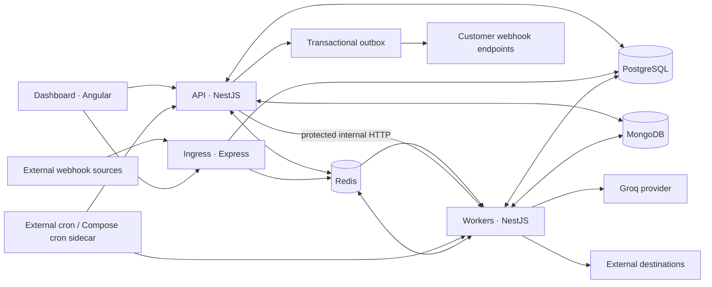
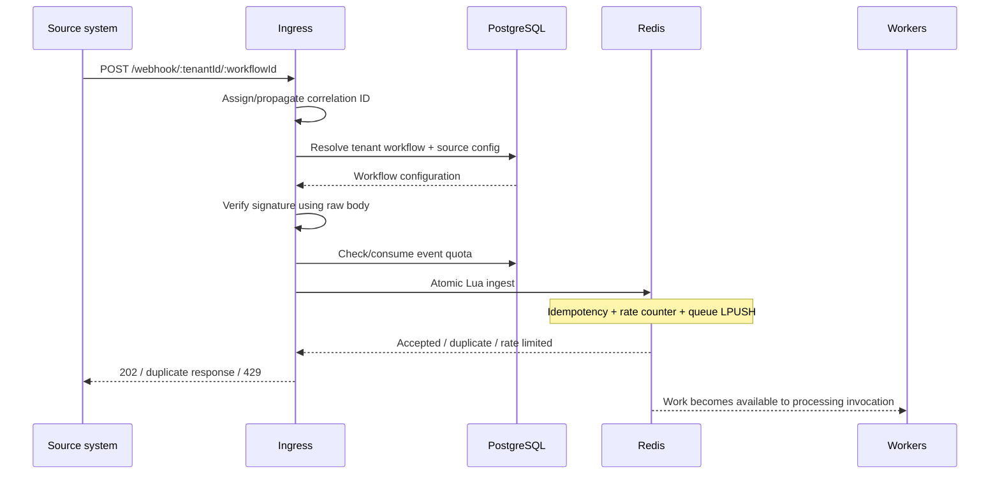
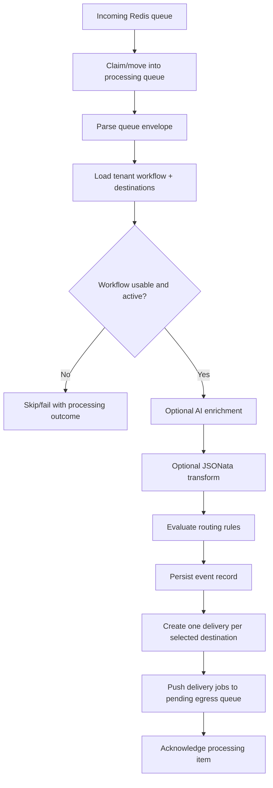

# Relayon — Architecture

> **System architecture, runtime topology, data contracts, reliability model and engineering trade-offs**
>
> **Repository:** [zainshah3464/relayon](https://github.com/zainshah3464/relayon)
> **Final version:** **v3.7.0** (project officially complete — 24 November 2026)
> **Final source snapshot:** [`f4dd930eafd2ab61381bc1c049bb6cdbb7480235`](https://github.com/zainshah3464/relayon/commit/f4dd930eafd2ab61381bc1c049bb6cdbb7480235)
> **License:** [Relayon Proprietary Source-Visible License v1.0](./LICENSE)

This document describes how Relayon is assembled, how requests/events move through it, and why the design is shaped the way it is. It is written for engineers who need to reason about the runtime — not just recognize the technologies in the package manifest.

---

## Table of Contents

1. [Architecture at a Glance](#1-architecture-at-a-glance)
2. [System Boundaries and Trust Zones](#2-system-boundaries-and-trust-zones)
3. [The Four Applications](#3-the-four-applications)
4. [Runtime Communication and Service Contracts](#4-runtime-communication-and-service-contracts)
5. [Data Stores and Ownership](#5-data-stores-and-ownership)
6. [Inbound Webhook Architecture](#6-inbound-webhook-architecture)
7. [Atomic Ingest, Deduplication and Quota Controls](#7-atomic-ingest-deduplication-and-quota-controls)
8. [Event Processing Architecture](#8-event-processing-architecture)
9. [AI Enrichment and Transformation](#9-ai-enrichment-and-transformation)
10. [Routing and Destination Fan-Out](#10-routing-and-destination-fan-out)
11. [Delivery, Retries and Recovery](#11-delivery-retries-and-recovery)
12. [Scheduling and Distributed Coordination](#12-scheduling-and-distributed-coordination)
13. [Workflow Configuration, History and Portability](#13-workflow-configuration-history-and-portability)
14. [Customer-Facing Webhook Outbox](#14-customer-facing-webhook-outbox)
15. [Identity, Tenant Isolation and Secrets](#15-identity-tenant-isolation-and-secrets)
16. [AI Assistant and Knowledge Retrieval](#16-ai-assistant-and-knowledge-retrieval)
17. [Control-Plane Capabilities Around the Core](#17-control-plane-capabilities-around-the-core)
18. [Dashboard Rendering and Client Architecture](#18-dashboard-rendering-and-client-architecture)
19. [SDK, CLI and Public Integration Surfaces](#19-sdk-cli-and-public-integration-surfaces)
20. [Deployment Topologies](#20-deployment-topologies)
21. [Observability and Operational Controls](#21-observability-and-operational-controls)
22. [Testing and Delivery Pipeline](#22-testing-and-delivery-pipeline)
23. [Failure Modes and Recovery Behavior](#23-failure-modes-and-recovery-behavior)
24. [Reliability Guarantees and Non-Guarantees](#24-reliability-guarantees-and-non-guarantees)
25. [Scaling Characteristics and Trade-Offs](#25-scaling-characteristics-and-trade-offs)
26. [Security Boundaries and Production Considerations](#26-security-boundaries-and-production-considerations)
27. [Repository Map](#27-repository-map)
28. [Architecture Decisions and Rationale](#28-architecture-decisions-and-rationale)
29. [Source References](#29-source-references)

---

## 1. Architecture at a Glance

Relayon is a **webhook relay and event-integration platform**. It accepts events from external systems, validates and queues them, processes them asynchronously, optionally enriches and transforms their payloads, applies routing rules, and delivers the result to one or more configured destinations.

A workflow can also be triggered by a persisted schedule. Scheduled events enter the **same processing pipeline** as webhook events — they are not a separate delivery engine.

### High-Level Topology



The four application processes are independently deployable, but they are **not isolated from one another** in the sense of having no direct service calls. The normal event path is coordinated through Redis and shared persistence. Selected control-plane operations also make **protected internal HTTP calls** from the API to Workers — for example, destination dry-run, workflow test-run, schedule run-now and adapter catalogue lookup.

### Architectural Responsibilities

| Component | Primary responsibility | State it owns or uses |
|---|---|---|
| Dashboard | Human-facing control plane | Browser state, auth session and presentation state |
| API | Authenticated control plane and product APIs | PostgreSQL transactional records; reads event/delivery records from MongoDB; Redis-backed supporting capabilities |
| Ingress | Public data-plane edge | Reads workflow/source configuration and quota state; uses Redis for atomic admission and queueing |
| Workers | Asynchronous data-plane execution | Reads workflow/destination config; writes event/delivery records; consumes and produces Redis jobs |
| PostgreSQL | Transactional system of record | Tenants, users, workflows, destinations, schedules, versions, keys, quotas, integration records, outbox records |
| MongoDB | Event and delivery persistence | Event and destination-delivery documents, including lifecycle/status and expiry metadata |
| Redis | Coordination and transient work state | Queues, delayed work, idempotency markers, rate counters, caches, presence, temporary capture buffers |

### A Critical Separation

The ingress service returns **after** a request has passed admission and has been placed on the queue. That response does **not** mean AI enrichment, transformation or all downstream deliveries have completed. Processing and delivery are later worker operations with their own statuses and retry behavior.

---

## 2. System Boundaries and Trust Zones

Relayon has multiple entry points, and they do not all have the same trust model.

| Zone | Entry point | Trust assumption | Main controls |
|---|---|---|---|
| Browser/user | Dashboard and API | User-controlled client | JWT session, route guards, API authorization, tenant scope |
| Programmatic client | API endpoints | API key or JWT bearer | API-key hash verification, scope checks, tenant ownership |
| Webhook producer | Ingress `/webhook/:tenantId/:workflowId` | External; untrusted until verified | Source-specific HMAC verification, payload limits, quota, idempotency, rate limiting |
| Internal scheduler/cron | Workers `/internal/*` and API cron routes | Trusted deployment scheduler only | Shared `CRON_SECRET`, protected controllers, database coordination |
| Destination/provider | Outbound adapter request | External network and provider response are untrusted | Adapter timeouts, error classification, bounded retries, secret handling |
| Customer webhook receiver | Configured customer endpoint | External endpoint may fail or return malicious/unexpected responses | Signed payloads, timeout, status classification, retry limit, retention |

Ingress and Workers are deliberately separate from the authenticated control-plane API. Ingress has a **narrow responsibility**: authenticate the inbound event at the source boundary and enqueue accepted work. Workers execute user-configured integrations and therefore have a broader outbound-network and credential-handling responsibility.

The API is **not** a universal proxy for event traffic. It manages configuration and provides product capabilities; the high-volume inbound webhook route lives in the Ingress application.

---

## 3. The Four Applications

### 3.1 Dashboard — Angular 19

**Responsibility:** the user interface for tenant and platform operations.

The dashboard provides the workflow editor, destination configuration, event explorer, DLQ manager, analytics, settings, API-key management, schedules, version history, AI assistant, community, playground and platform-admin views.

The application uses Angular **standalone components** and lazy-loaded routes. Shared services handle authentication, API communication, language selection, notifications, modal/confirmation interactions, PWA behavior and SEO metadata.

The dashboard is **not** the security boundary. A hidden menu item or route guard improves navigation but does not replace authorization in the API. Every sensitive operation must still be checked server-side.

**Rendering model:** This is no longer accurately described as a purely static SPA with no server rendering. The current source has Angular **SSR/prerender** support. Public routes such as privacy, terms, guide, login and signup are configured for prerendering. Authenticated application routes — including dashboard, workflows, events, DLQ, analytics, settings, playground and admin — use client rendering. Community routes also remain client-rendered because they sit behind the authenticated shell in the current route design.

**PWA:** Service-worker and related UI code support install/update/offline-state experiences. This is an **installable web application**, not evidence of separately shipped native iOS and Android applications.

**Source:** [`apps/dashboard/src/app`](https://github.com/zainshah3464/relayon/tree/f4dd930eafd2ab61381bc1c049bb6cdbb7480235/apps/dashboard/src/app) · [SSR route policy](https://github.com/zainshah3464/relayon/blob/f4dd930eafd2ab61381bc1c049bb6cdbb7480235/apps/dashboard/src/app/app.routes.server.ts) · [Client routes](https://github.com/zainshah3464/relayon/blob/f4dd930eafd2ab61381bc1c049bb6cdbb7480235/apps/dashboard/src/app/app.routes.ts)

### 3.2 API — NestJS 11

**Responsibility:** authenticated control plane and product API.

The API owns the tenant-facing operations for:

- Account lifecycle, JWT sessions and OAuth.
- Tenant settings and membership/role-aware behavior.
- Workflow and destination configuration.
- Workflow version history, restore and YAML import/export.
- Events, delivery visibility and DLQ actions.
- Analytics, usage and quotas.
- API keys and rotation history.
- Schedules and manual run-now requests.
- Stripe billing and provider integrations.
- AI assistant and knowledge search.
- Customer webhook endpoint registration and outbox handling.
- Community, templates, moderation and administration.
- Playground, tunnel and supporting developer capabilities.

The API uses **Prisma** for PostgreSQL access and Mongoose-backed services for event/delivery reads. It also uses Redis for supporting state such as presence, provider resolution support and other transient capabilities.

At bootstrap, the API configures a global `/api` route prefix, CORS, validation and exception handling. It enables **raw-body capture** because Stripe webhook signature verification requires the exact request bytes. When configured, it exposes an **OpenAPI 3.1** document and Swagger UI. OpenAPI generation can be disabled with `DISABLE_OPENAPI=true`.

The API makes protected internal HTTP calls to Workers when an operation must execute in the worker runtime. These calls are guarded by the internal cron secret and depend on `WORKERS_URL` and `CRON_SECRET` being correctly configured.

**Source:** [API bootstrap](https://github.com/zainshah3464/relayon/blob/f4dd930eafd2ab61381bc1c049bb6cdbb7480235/apps/api/src/main.ts) · [API module composition](https://github.com/zainshah3464/relayon/blob/f4dd930eafd2ab61381bc1c049bb6cdbb7480235/apps/api/src/app.module.ts)

### 3.3 Ingress — Express 5

**Responsibility:** public data-plane entry point for inbound webhook traffic and developer capture routes.

Ingress currently handles:

- Signed workflow webhooks.
- Playground request capture under `/play`.
- Local development tunnel capture under `/t/:sessionId`.
- Health requests.

For workflow webhooks, it resolves the tenant/workflow configuration, verifies the configured source signature against the **raw request body**, checks event quota, creates/supplies a correlation ID, strips sensitive request headers from stored metadata, hashes client IP information and calls the atomic Redis ingest operation.

The Express JSON parser is configured with a **5 MB limit** and preserves the raw request buffer for signature checks. The service disables `x-powered-by`, trusts the configured proxy hop and applies CORS handling at its edge.

Ingress does **not** run AI enrichment, JSONata transformation or destination delivery. Keeping those operations out of the request path allows the source-facing HTTP request to finish once admission and queue insertion succeed.

The app exports an Express handler for Vercel serverless deployment. In a local/container process it also has a normal listener/bootstrap and dependency checks.

**Source:** [Ingress app](https://github.com/zainshah3464/relayon/blob/f4dd930eafd2ab61381bc1c049bb6cdbb7480235/apps/ingress/src/app.ts) · [Ingress entry point](https://github.com/zainshah3464/relayon/blob/f4dd930eafd2ab61381bc1c049bb6cdbb7480235/apps/ingress/src/index.ts) · [Webhook route](https://github.com/zainshah3464/relayon/blob/f4dd930eafd2ab61381bc1c049bb6cdbb7480235/apps/ingress/src/routes/webhook.ts)

### 3.4 Workers — NestJS 11

**Responsibility:** asynchronous data-plane execution.

Workers coordinate three main classes of work:

1. **Processing:** consume accepted events, load workflow configuration, optionally enrich and transform the payload, evaluate routing and persist the event/delivery jobs.
2. **Egress:** claim pending destination deliveries, decrypt destination config, invoke the registered adapter, record results, retry recoverable failures and move exhausted work to the DLQ.
3. **Scheduling:** claim due workflow schedules and enqueue synthetic events; also support manual schedule execution.

Workers additionally expose internal adapter discovery, destination dry-run, workflow test processing, event replay and health/status operations.

The NestJS application uses an `/internal` prefix. Its internal controllers use the shared cron-secret guard. The Vercel handler **caches the underlying HTTP adapter** after the first initialization so warm invocations reuse the application instance. In container/local execution the worker app can run as a normal service.

**Source:** [Workers entry point](https://github.com/zainshah3464/relayon/blob/f4dd930eafd2ab61381bc1c049bb6cdbb7480235/apps/workers/src/main.ts) · [Workers module](https://github.com/zainshah3464/relayon/blob/f4dd930eafd2ab61381bc1c049bb6cdbb7480235/apps/workers/src/app.module.ts)

### 3.5 Local Development Ports

The local-development defaults used by the project are:

| App | Port |
|---|---:|
| Dashboard | `4200` |
| API | `3001` |
| Ingress | `3002` |
| Workers | `3003` |

These are **development/runtime defaults**, not a promise that a production deployment uses those public ports. In Docker Compose, only the reverse proxy publishes the user-facing HTTP port; the application services are exposed on the internal Compose network.

---

## 4. Runtime Communication and Service Contracts

The system uses shared persistence and queues for the main event path, plus narrow internal HTTP calls for synchronous control-plane operations.

### 4.1 Communication Matrix

| Caller | Callee | Protocol | Purpose |
|---|---|---|---|
| Browser | API | HTTPS/JSON, bearer session or API key | Product/control-plane API |
| Browser | Ingress | HTTPS/JSON | Workflow webhooks when testing/using ingress directly; playground/tunnel UI capture paths |
| Source provider | Ingress | HTTPS webhook | Submit signed event |
| Ingress | PostgreSQL | Prisma/SQL | Resolve workflow and apply quota admission state |
| Ingress | Redis | Redis commands/Lua | Idempotency, rate counter and inbound queue insertion |
| Workers | Redis | Redis commands/Lua | Claim/process queues, delayed jobs and caches |
| Workers | PostgreSQL | Prisma/SQL | Read tenant/workflow/destination/schedule configuration and usage state |
| Workers | MongoDB | Mongoose | Persist and claim event/delivery documents |
| API | Workers | Protected internal HTTP | Dry-run, adapter discovery, test-run and run-now paths |
| Cron scheduler | Workers | Protected internal HTTP | Process, deliver and tick schedules |
| Cron scheduler | API | Protected internal HTTP | Outbox polling and selected maintenance jobs |
| Workers | External providers | HTTPS/driver protocols | Send destination deliveries |
| API outbox poller | Customer endpoints | HTTPS | Signed Relayon event notifications |

### 4.2 Internal HTTP Is Deliberately Narrow

Internal HTTP calls exist where the API needs an operation to run **inside the Workers process**, but the API should remain the entry point for a tenant request. Examples include:

- `POST /internal/egress/dry-run` — execute a destination's safe validation path.
- `GET /internal/adapters` — retrieve the currently registered adapter catalogue.
- `POST /internal/process/test` — execute a workflow test path against sample input **without** creating production delivery side effects.
- `POST /internal/schedule/run-now` — enqueue an immediate synthetic schedule event.

The internal endpoints are **not** intended as public unauthenticated APIs. Their deployment contract includes `WORKERS_URL` and `CRON_SECRET` on the calling side, plus the cron-secret guard on the Workers side.

### 4.3 Why the Main Path Is Queue-Based

A source webhook should not wait for an LLM call, destination network, provider throttling or a downstream database insert. Queueing separates source acknowledgement from work completion and lets processing/delivery be retried independently.

This does **not** remove failure modes: Redis availability is part of the admission path, and workers must be invoked by a scheduler in serverless deployment or run continuously in a container deployment.

---

## 5. Data Stores and Ownership

Relayon uses PostgreSQL, MongoDB and Redis because the data has **three different operational shapes**. They are not interchangeable replicas of the same database.

### 5.1 PostgreSQL — Transactional / Control-Plane Store

PostgreSQL, accessed through Prisma, holds durable relational configuration and account state, including:

- Tenants and users.
- Authentication refresh tokens and account verification/reset records.
- Workflows and destinations.
- Workflow schedules and workflow version snapshots.
- API keys and key-rotation history.
- Provider integration metadata and encrypted credentials.
- Usage counters and quota settings.
- Stripe customer/subscription linkage.
- Customer webhook endpoints and outbox events.
- Community, moderation, audit and selected product-tracking records.

Relational constraints and transactions are used for operations where consistency matters, such as workflow/version capture and database-backed usage/claim updates. The Prisma service also provides **tenant-aware transaction helpers** and the project includes PostgreSQL **RLS policies**.

### 5.2 MongoDB — Event and Delivery Documents

MongoDB is used for the higher-volume, flexible-shaped event and destination-delivery records. Arbitrary webhook payloads do not need a schema migration every time a source adds a field.

The Workers application writes event and delivery documents; the API exposes read/management operations over these collections. Event and delivery collections in the processing service define **30-day retention** constants, and the corresponding schema/index definitions provide TTL cleanup behavior.

An **event** represents the accepted/processed source event. A **delivery** represents one attempt lifecycle for one destination. That separation is fundamental to fan-out: one event may have multiple destination deliveries with different outcomes.

### 5.3 Redis — Queues, Coordination and Ephemeral State

Redis is used for:

- Incoming event queue.
- Processing/in-flight event queue.
- Pending egress delivery queue.
- Delayed egress sorted set.
- Ingress idempotency markers.
- Ingress rate-limit counters.
- AI rate-limit counters and enrichment cache.
- Circuit-breaker state and selected transient locks/state.
- Presence heartbeats.
- Playground and tunnel request buffers/streams.
- Short-lived resolver/cache data.

Redis is the **coordination layer**, not the authoritative store for workflow definitions or billing data. Persistent records remain in PostgreSQL or MongoDB according to their ownership.

### 5.4 Store Responsibilities at a Glance

| Data | Primary store | Why |
|---|---|---|
| Tenant, user, workflow, destination config | PostgreSQL | Relations, transactions, ownership and constraints |
| Workflow history | PostgreSQL | Immutable relational snapshots and ordered versions |
| Usage/quota counters | PostgreSQL | Atomic conditional increments and period accounting |
| Event/delivery history | MongoDB | Flexible event payloads and independent delivery lifecycles |
| Incoming/processing/pending work | Redis | Fast queue coordination between stateless invocations |
| Delayed retries | Redis sorted set | Time-ordered eligibility for next attempts |
| Idempotency/rate windows | Redis | Atomic admission and expiring keys |
| Live presence and temporary captures | Redis | TTL-based ephemeral state |
| Outbound platform-event outbox | PostgreSQL | Durable record committed with application changes |

### 5.5 Cross-Store Consistency

There is **no single ACID transaction** spanning PostgreSQL, MongoDB and Redis. The architecture therefore uses explicit hand-off and recovery mechanisms:

- PostgreSQL transactions for relational state and outbox records.
- Redis atomic scripts for admission steps that must happen together in Redis.
- MongoDB atomic document claims for individual deliveries.
- Redis processing queues and stale-work recovery for interrupted worker execution.
- Outbox polling and leases for customer-facing webhook delivery.

A failure between stores can still require retries or reconciliation. The design targets **recoverable at-least-once processing**; it does **not** claim globally exactly-once side effects across all three stores and external providers.

---

## 6. Inbound Webhook Architecture

### 6.1 Supported Source Verification

The ingress verifier supports the source types implemented in the repository:

| Source | Signature mechanism |
|---|---|
| Stripe | Timestamped HMAC-SHA256 over Stripe's signed request representation |
| GitHub | HMAC-SHA256 using `X-Hub-Signature-256` |
| Shopify | HMAC-SHA256 with the provider's base64 encoding |
| Slack | Timestamped Slack signing-base-string verification |
| Generic | Configured generic HMAC-SHA256 signature |

The verifier **must operate on the raw request bytes**. JSON parsing followed by re-serialization can produce different bytes and break a correct HMAC comparison. The Express JSON parser therefore preserves the raw buffer on the request object.

### 6.2 Request Path



In detail, the current route:

1. Accepts the path-scoped tenant and workflow identifiers.
2. Creates or propagates an `X-Correlation-Id` value.
3. Resolves the workflow and tenant context.
4. Verifies the source signature using the relevant source configuration.
5. Applies monthly event quota admission.
6. Builds a queue envelope containing event/workflow/tenant/correlation context and payload metadata.
7. Removes sensitive request headers from retained header metadata.
8. Hashes client IP information with the configured salt rather than using the raw IP as a normal event identifier.
9. Invokes the atomic Redis admission script.
10. Returns the source-facing result after Redis reports accepted, duplicate or rate-limited.

### 6.3 Admission Responses

| Result | Meaning |
|---|---|
| **Accepted** | Event admitted and pushed onto the Redis incoming queue. Not necessarily processed yet. |
| **Duplicate** | Idempotency marker already existed; the route does not enqueue a second copy through the normal path. |
| **Rate limited** | The tenant's ingress counter exceeded the configured per-minute limit. |
| **Quota exceeded** | Monthly event usage disallowed admission under the tenant's hard/soft quota configuration. |
| **Invalid signature** | The request did not authenticate as the configured source. |
| **Dependency failure** | Ingress could not safely complete workflow resolution, quota admission or queue insertion; a source retry may be required. |

The route's `RATE_LIMIT_PER_MINUTE` default is **1,000** in the audited source, and the counter is **tenant-scoped** in the current webhook path. It is separate from monthly quota accounting. The old v1.5 architecture figure of "300 requests/minute per workflow" does **not** describe the current code.

### 6.4 Ingress Resource Boundary

The JSON body limit is **5 MB**. Ingress handles the provider-facing validation and queue hand-off only. AI calls, destination network requests and event fan-out are deferred to Workers.

**Source:** [Webhook route](https://github.com/zainshah3464/relayon/blob/f4dd930eafd2ab61381bc1c049bb6cdbb7480235/apps/ingress/src/routes/webhook.ts) · [Signature middleware](https://github.com/zainshah3464/relayon/blob/f4dd930eafd2ab61381bc1c049bb6cdbb7480235/apps/ingress/src/middleware/signature.ts) · [Source verifiers](https://github.com/zainshah3464/relayon/blob/f4dd930eafd2ab61381bc1c049bb6cdbb7480235/apps/ingress/src/services/verifiers.ts)

---

## 7. Atomic Ingest, Deduplication and Quota Controls

### 7.1 One Redis Script for the Admission Critical Section

The primary webhook handler uses `atomicIngest()` from `apps/ingress/src/lib/redis-batch.ts`. The Lua script receives three Redis keys:

- Idempotency key.
- Rate-counter key.
- Incoming event queue key.

It performs, in order:

1. `SET idempotencyKey 1 EX ttl NX`.
2. `INCR rateCounter`, setting its expiry on the first increment.
3. Compare the counter against the configured limit.
4. `LPUSH` the event envelope only when admission passes.
5. Return an explicit status and queue depth.

The default idempotency TTL is **86,400 seconds (24 hours)**. Keeping the admission operations in one Lua execution prevents application-level interleaving between the individual Redis round trips.

The same file retains a basic pipelined helper for idempotency/queue operations, but the webhook handler's main path uses the atomic script with rate limiting included.

### 7.2 Two Different Limit Systems

Do **not** conflate these controls:

- **Ingress request rate limit:** a short time-window counter in Redis, used to protect the HTTP admission path.
- **Tenant quota:** monthly usage limits and counters in PostgreSQL, used for plan/usage accounting.

The quota module supports event, AI-token and delivery metrics. Its hard/soft behavior is evaluated separately from the Redis per-minute counter. Quota snapshots expose configured limits, used values and reset information.

### 7.3 Deduplication Is Scoped, Not Universal

Ingress idempotency prevents an equivalent source request from being admitted again during the retention window. The exact key derivation includes the workflow/tenant context and request event identity available to the route. This does **not** create a universal exactly-once guarantee for destination side effects.

Further protection exists at later boundaries:

- The processing/event persistence path has a correlation/event identity constraint.
- Delivery workers claim a delivery record atomically before calling an adapter.
- The HTTP adapter can send an idempotency header derived from event and destination identity.
- Consumers of Relayon's customer webhooks should verify the signed message and use the webhook event ID for their own deduplication.

**Source:** [Atomic ingest Lua script](https://github.com/zainshah3464/relayon/blob/f4dd930eafd2ab61381bc1c049bb6cdbb7480235/apps/ingress/src/lib/redis-batch.ts) · [Ingress quota helper](https://github.com/zainshah3464/relayon/blob/f4dd930eafd2ab61381bc1c049bb6cdbb7480235/apps/ingress/src/lib/quota.ts) · [Quota service](https://github.com/zainshah3464/relayon/blob/f4dd930eafd2ab61381bc1c049bb6cdbb7480235/apps/api/src/modules/quota/quota.service.ts)

---

## 8. Event Processing Architecture

Workers turn an accepted queue envelope into an event record and zero or more destination delivery records.

### 8.1 Processing Lifecycle



The exact result object returned by a process batch records counts for processed/succeeded/failed/skipped events, duration and a breakdown including enrichment/cache behavior, transformations and queued egress jobs.

### 8.2 Bounded Processing

Workers are designed to process **bounded batches** rather than rely on a single permanently running in-memory loop in serverless deployments. Batch size and time-budget settings constrain how much work an invocation attempts before returning. Any remaining or interrupted work is handled through queue state and recovery operations.

### 8.3 Event and Delivery Records Are Separate

The MongoDB event record represents the source event and processing context. Each selected destination creates its **own delivery record**. Therefore, processing can complete successfully while one destination is retrying and another is already delivered.

This model makes it possible to debug an event's transformation/routing outcome independently from a downstream provider outage.

### 8.4 Persistence and Retention

The processing service defines **30-day** event and delivery retention constants. The Mongo schema layer includes expiry/index support; retention is not meant to be an indefinite event archive. Long-term retention requirements should be met by exporting data into an explicitly managed storage/warehouse system.

### 8.5 Event Replay vs DLQ Replay

**Event replay** re-enters the event-processing path for an event. **Delivery/DLQ replay** re-attempts a specific failed destination delivery. These operations have different scopes and can produce different side effects; operators should choose the one that matches the failure stage.

**Source:** [Processing service](https://github.com/zainshah3464/relayon/blob/f4dd930eafd2ab61381bc1c049bb6cdbb7480235/apps/workers/src/modules/processing/processing.service.ts) · [Processing controller](https://github.com/zainshah3464/relayon/blob/f4dd930eafd2ab61381bc1c049bb6cdbb7480235/apps/workers/src/modules/processing/processing.controller.ts)

---

## 9. AI Enrichment and Transformation

### 9.1 AI Enrichment Is Optional Processing Middleware

A workflow can enable Groq-backed enrichment and supply an enrichment prompt. The worker passes the event payload and workflow prompt to the configured provider/model and expects a structured response that can be attached to the event context.

The current implementation has a **provider-key resolution path** and an **AI rate limiter**. A tenant's active BYOK integration can be selected before the platform environment fallback, depending on resolver configuration. Enrichment results are cached in Redis for a bounded TTL to avoid repeating identical provider work.

AI must **not** become a dependency for receiving the source webhook. Provider timeout, quota exhaustion or invalid credentials should be treated as an enrichment problem, not proof that the inbound source event was invalid. The processing path contains error handling so optional enrichment can degrade without necessarily blocking the non-AI workflow path.

The model output is **probabilistic**. It must not be treated as a verified source fact or used as the sole authority for security, financial approval or other high-impact policy decisions.

**Source:** [Groq enrichment service](https://github.com/zainshah3464/relayon/blob/f4dd930eafd2ab61381bc1c049bb6cdbb7480235/apps/workers/src/modules/processing/groq.service.ts) · [AI rate limiter](https://github.com/zainshah3464/relayon/blob/f4dd930eafd2ab61381bc1c049bb6cdbb7480235/apps/workers/src/modules/processing/ai-rate-limiter.service.ts) · [Provider resolver](https://github.com/zainshah3464/relayon/blob/f4dd930eafd2ab61381bc1c049bb6cdbb7480235/apps/api/src/modules/integrations/provider-resolver.ts)

### 9.2 JSONata Transformation

The transform service uses **JSONata** to reshape or derive fields from a JSON payload. This is a data transformation language, **not** arbitrary user-authored JavaScript evaluation.

The workflow can store a transform expression. Workers evaluate it during processing, and the API exposes a **preview** operation so a user can try an expression with sample input before saving it. The transform service places a **bounded time limit** around evaluation to prevent an expression from holding a worker invocation indefinitely.

Transformation has a distinct failure mode from provider delivery. A malformed or failing expression is a processing-stage issue and should be diagnosed from the event's processing details before replaying destination deliveries.

**Source:** [Transform service](https://github.com/zainshah3464/relayon/blob/f4dd930eafd2ab61381bc1c049bb6cdbb7480235/apps/workers/src/modules/processing/transform.service.ts) · [Workflow transform preview](https://github.com/zainshah3464/relayon/blob/f4dd930eafd2ab61381bc1c049bb6cdbb7480235/apps/api/src/modules/workflows/workflows.controller.ts)

---

## 10. Routing and Destination Fan-Out

After enrichment and transformation, the routing service decides which workflow destinations should receive the payload.

### 10.1 Rule Model

A routing rule has:

- A `when` expression evaluated using JSONata.
- A list of destination IDs to select when the rule matches.

Rules are evaluated in their configured order. The **first matching rule** determines the destination set.

### 10.2 Routing Semantics

| Configuration | Result |
|---|---|
| No routing rules | All eligible/enabled workflow destinations are selected |
| One or more rules; first rule matches | Destination IDs from that rule are selected |
| Earlier rules do not match; later rule matches | Destination IDs from the first matching later rule are selected |
| Rules exist but none match | No destination is selected; the result records that no rule matched |

The **no-rules** behavior is intentionally different from the **no-matching-rule** behavior. An empty rule set means ordinary fan-out; an explicit ruleset with no true condition does **not** silently fall back to all destinations.

### 10.3 Fan-Out Isolation

Each selected destination gets a **separate delivery job and delivery record**. One destination's latency or failure does not change another destination's status. It does, however, contribute to overall worker load and queue depth.

**Source:** [Routing service](https://github.com/zainshah3464/relayon/blob/f4dd930eafd2ab61381bc1c049bb6cdbb7480235/apps/workers/src/modules/processing/routing.service.ts) · [Processing service](https://github.com/zainshah3464/relayon/blob/f4dd930eafd2ab61381bc1c049bb6cdbb7480235/apps/workers/src/modules/processing/processing.service.ts)

---

## 11. Delivery, Retries and Recovery

### 11.1 Adapter Abstraction

Workers resolve a destination adapter through an adapter registry. All built-in adapters implement the common delivery adapter contract and receive a delivery context containing the destination configuration, payload, event/correlation identifiers and attempt metadata.

The **nine built-in destinations** in the audited source are:

1. HTTP webhook
2. Slack incoming webhook
3. Email (Resend integration)
4. Google Sheets
5. Discord webhook
6. Airtable
7. Notion
8. PostgreSQL
9. MongoDB

The registry also supports **metadata discovery** for the dashboard and an **external-adapter loader** path described later in this document.

**Source:** [Adapter directory](https://github.com/zainshah3464/relayon/tree/f4dd930eafd2ab61381bc1c049bb6cdbb7480235/apps/workers/src/modules/egress/adapters) · [Adapter types](https://github.com/zainshah3464/relayon/blob/f4dd930eafd2ab61381bc1c049bb6cdbb7480235/apps/workers/src/modules/egress/adapters/types.ts)

### 11.2 External Adapter Loading

In addition to built-in providers, Workers contains an **external-adapter loader**. The loader discovers adapter directories, reads each `manifest.json`, validates its metadata, resolves the configured entrypoint and rejects unsafe path resolution or duplicate adapter types before registration.

An adapter can declare **sandboxed trust**. Sandboxed adapters execute through a worker-thread runner with a restricted execution bridge, a bounded runtime and controlled HTTPS fetch support. This reduces the privileges exposed to the adapter code, but it is **not** a substitute for reviewing the adapter itself, its dependencies, the URLs it can contact or the secrets passed to it. Operators should treat third-party adapter code as executable integration code and apply an explicit supply-chain and egress policy.

**Source:** [External adapter loader](https://github.com/zainshah3464/relayon/blob/f4dd930eafd2ab61381bc1c049bb6cdbb7480235/apps/workers/src/modules/egress/adapters/loader/adapter-loader.service.ts) · [Sandbox runner](https://github.com/zainshah3464/relayon/blob/f4dd930eafd2ab61381bc1c049bb6cdbb7480235/apps/workers/src/modules/egress/adapters/loader/sandbox-runner.ts)

### 11.3 Delivery Claim

A pending delivery job is resolved to its MongoDB delivery record and **claimed with an atomic status transition** before the external request is made. This reduces the chance that two concurrent worker invocations perform the same attempt at the same time.

The adapter receives **decrypted configuration** only inside the worker execution path. A credential decryption failure is a delivery failure; the system must **not** send ciphertext to the destination as though it were a usable credential.

### 11.4 Retry Policy

The default retry policy is defined centrally:

| Attempt | Delay before next retry |
|---:|---:|
| 1 | 10 seconds |
| 2 | 30 seconds |
| 3 | 1 minute |
| 4 | 5 minutes |
| 5 | 15 minutes |

The default maximum is **five attempts**. The parser also accepts the destination's configured retry-policy object, handles snake_case/camelCase property names and clamps `maxAttempts` into the supported **1–10** range. Invalid/missing policy falls back to defaults.

Delayed deliveries are represented in a **Redis sorted set**, with the next eligible time as the score. A worker invocation promotes due work back into the pending delivery path.

### 11.5 Circuit Breaker

The egress layer has destination-scoped **circuit-breaker** state. Repeated failures can temporarily defer calls to an unhealthy destination rather than allowing a provider outage to consume every delivery invocation. Circuit state is held in Redis and is shared across worker instances.

A circuit breaker is a **load-shedding/recovery control**, not a replacement for retry policy. A delivery may be delayed while the circuit is open and later retried; it is **not** automatically proof that the provider has recovered.

### 11.6 Stuck Delivery Recovery

The egress service includes a **five-minute threshold** for identifying records that remain in `delivering` beyond the expected attempt window. Recovery logic can return stale deliveries to a retryable/pending path so a worker crash does not leave them permanently claimed.

This is a **recovery heuristic**. If a worker timed out after the provider accepted a write but before Relayon stored the success result, a retry can result in a **duplicate external side effect**. Consumers should use idempotency where supported.

### 11.7 Dead-Letter Queue

When a delivery exhausts its retry budget or encounters a terminal error, it is moved to a **DLQ status**. The API exposes tenant-scoped operations to:

- List DLQ records.
- Replay one delivery.
- Bulk replay selected delivery IDs (the service caps a bulk request at **100 unique IDs**).
- Discard one delivery.
- Bulk discard selected IDs.

Bulk operations filter by tenant and DLQ status before changing records. Operators should diagnose the underlying provider/configuration problem **before** replaying large batches.

### 11.8 Destination Validation Is Not Production Delivery

The API destination-validation operation performs schema checks and can call the protected worker dry-run endpoint when the worker URL and cron secret are configured. The dry-run path uses a synthetic payload and adapter-specific non-writing probes where available.

A dry-run can establish that configuration is **structurally valid** or that a safe provider probe succeeded. It **cannot** prove that a real business payload will be accepted or that a destination's downstream business process completed. Slack/Discord webhook endpoints do not offer a safe non-writing message test; configuration checks must not be represented as a successful real post.

**Source:** [Egress service](https://github.com/zainshah3464/relayon/blob/f4dd930eafd2ab61381bc1c049bb6cdbb7480235/apps/workers/src/modules/egress/egress.service.ts) · [Retry policy](https://github.com/zainshah3464/relayon/blob/f4dd930eafd2ab61381bc1c049bb6cdbb7480235/apps/workers/src/modules/egress/retry-policy.ts) · [Circuit breaker](https://github.com/zainshah3464/relayon/tree/f4dd930eafd2ab61381bc1c049bb6cdbb7480235/apps/workers/src/modules/egress) · [DLQ service](https://github.com/zainshah3464/relayon/blob/f4dd930eafd2ab61381bc1c049bb6cdbb7480235/apps/api/src/modules/dlq/dlq.service.ts) · [Destination validation](https://github.com/zainshah3464/relayon/blob/f4dd930eafd2ab61381bc1c049bb6cdbb7480235/apps/api/src/modules/destinations/destinations.service.ts)

---

## 12. Scheduling and Distributed Coordination

Relayon has two related but distinct scheduling mechanisms:

1. **Tenant-defined workflow schedules** that generate events.
2. **Platform cron operations** that invoke workers/API maintenance and polling tasks.

### 12.1 Tenant Workflow Schedules

A workflow schedule is stored in **PostgreSQL** with its cron expression, timezone, payload template, active flag, last-run timestamp and next-run timestamp.

The worker schedule-tick endpoint queries due active schedules. It computes the next run and uses a **conditional database update** that includes the due-time predicate. Only the caller that successfully changes the still-due row proceeds to enqueue the synthetic event. Concurrent ticks therefore do **not** both intentionally claim the same due schedule.

The resulting synthetic event is sent to the normal incoming queue and proceeds through processing, transformation, routing and egress like a webhook-originated event.

### 12.2 Run-Now

The dashboard/API **run-now** operation calls the protected Workers route. Workers enqueue a synthetic schedule event immediately. The normal cron `nextRunAt` is **not** advanced merely because a manual run was requested; it remains the schedule's next planned time.

### 12.3 Bulk Schedule Operations

The API supports bulk **pause-all** and **resume-all** operations for a tenant. Resume **recomputes next-run timestamps** so that a paused backlog does not automatically create an immediate-fire storm. A bulk delete operation removes tenant schedules without deleting the workflows themselves.

### 12.4 Platform Cron and External Invocation

The codebase uses **scheduled HTTP invocations** because serverless processes do not remain alive as background daemons. Workers expose operations for processing, delivery and schedule ticks. The API also exposes cron routes for customer-webhook outbox polling and maintenance tasks.

### 12.5 Coordination Primitives Are Chosen by Job Semantics

The repository includes more than one database coordination pattern:

| Mechanism | Used for | Semantics |
|---|---|---|
| Conditional schedule update | Claiming a due workflow schedule | Only one caller should advance a particular still-due schedule row |
| `FOR UPDATE SKIP LOCKED` plus lease | Claiming outbox batches | Concurrent pollers skip already-claimed rows; lease allows later recovery |
| PostgreSQL transaction-scoped advisory lock | Maintenance jobs that should run once across instances | `pg_try_advisory_xact_lock`; transaction completion or connection loss releases the lock |
| Redis atomic Lua script | Ingress admission | Idempotency, rate counter and queue push in one Redis operation |
| MongoDB conditional update | Claiming individual delivery | Atomic pending-to-delivering ownership transition |

The `withAdvisoryLock()` helper explicitly distinguishes jobs that should run **once** from **at-least-once** batch work. It uses a transaction-scoped PostgreSQL advisory lock. For batch/polling work, the code uses row-lock/lease patterns instead.

**Source:** [Worker schedule service](https://github.com/zainshah3464/relayon/tree/f4dd930eafd2ab61381bc1c049bb6cdbb7480235/apps/workers/src/modules/schedule) · [Schedule API](https://github.com/zainshah3464/relayon/tree/f4dd930eafd2ab61381bc1c049bb6cdbb7480235/apps/api/src/modules/schedules) · [PostgreSQL cron lock](https://github.com/zainshah3464/relayon/blob/f4dd930eafd2ab61381bc1c049bb6cdbb7480235/apps/api/src/common/cron/pg-cron-lock.ts)

---

## 13. Workflow Configuration, History and Portability

### 13.1 Workflow Configuration as Durable State

A workflow is a **PostgreSQL-owned configuration aggregate**. It captures the source type/configuration, active status, enrichment settings, transform expression, routing rules and related destination records.

Workflow creation and update are performed through tenant-scoped API services. The create/update path **captures a version snapshot in the same database transaction** as the workflow mutation, avoiding a gap where the workflow exists but its corresponding first version is missing.

### 13.2 Version Snapshots

Workflow versions store **immutable snapshots** of the configuration at each captured change. The version service supports:

- Listing versions.
- Retrieving a particular version.
- Comparing two versions with a unified line-based patch.
- Restoring a selected version.

The repository caps retained history at **50 versions** per workflow. Restore applies historical configuration as a new current state and **records a new version**; it does not delete the later history. Destination records can be recreated as part of restore, so destination database IDs should **not** be assumed to remain stable across restored snapshots.

### 13.3 YAML Portability

The API supports single-workflow and bulk **YAML export**, plus **import**. Secret values are redacted/replaced with variable placeholders for portability; unresolved placeholders are validated during import rather than silently being treated as real credentials.

The repository also includes `scripts/relayon-sync.mjs`, exposed through:

```bash
npm run workflows:pull
npm run workflows:validate
npm run workflows:push
```

The sync client reads `RELAYON_API_URL`, `RELAYON_API_TOKEN` and `RELAYON_WORKFLOWS_DIR`. This gives a team a **file-based workflow configuration path** that can be reviewed and tracked in its own Git repository.

### 13.4 Workflow Test-Run vs a Real Event

The **workflow test-run** calls a protected worker-side path and runs the pipeline against a sample payload. It returns stage-level results for enrichment, transform and routing **without persisting a production event and fanning out real destination deliveries**. An assertion layer can evaluate JSONata conditions against the test result.

This is intended for **pipeline logic validation**. It does **not** prove that an actual destination write will succeed; destination dry-run and a controlled end-to-end delivery are separate checks.

**Source:** [Workflow API/service](https://github.com/zainshah3464/relayon/tree/f4dd930eafd2ab61381bc1c049bb6cdbb7480235/apps/api/src/modules/workflows) · [Workflow test module](https://github.com/zainshah3464/relayon/tree/f4dd930eafd2ab61381bc1c049bb6cdbb7480235/apps/api/src/modules/workflows/testing) · [YAML sync script](https://github.com/zainshah3464/relayon/blob/f4dd930eafd2ab61381bc1c049bb6cdbb7480235/scripts/relayon-sync.mjs)

---

## 14. Customer-Facing Webhook Outbox

Relayon has **two webhook directions**:

- **Inbound:** external providers send events into a workflow through Ingress.
- **Outbound platform notifications:** Relayon sends lifecycle notifications to endpoints registered by a tenant.

These are separate subsystems and should not be conflated.

### 14.1 Transactional Write Path

The API outbox service writes an outbox row in PostgreSQL. Where a caller already has a Prisma transaction, the outbox service can use that transaction client so the **business change and the outbox record are committed together**.

Supported event types include workflow lifecycle events, event/delivery lifecycle events and quota warning/exceeded notifications as enumerated by the service's event type union.

### 14.2 Polling and Claiming

The poller selects pending events that are due, using **`FOR UPDATE SKIP LOCKED`** and a time-based lease. The current poller constants include:

| Setting | Current implementation |
|---|---:|
| Claim batch | 10 outbox rows |
| Endpoint fetch timeout | 3 seconds |
| Claim lease | 60 seconds |
| Maximum attempts | 20 |
| Backoff base | 30 seconds |
| Backoff ceiling | 1 hour |

The backoff uses exponential growth with jitter. Expired pending records are marked failed instead of being retried indefinitely.

### 14.3 Standard Webhooks-Compatible Signing

For each matching active endpoint, the poller serializes the event payload, decrypts the endpoint signing secret and sends a signed HTTP request using **`webhook-id`**, **`webhook-timestamp`** and **`webhook-signature`** headers. The signature input is based on the event ID, timestamp and raw payload body.

A receiving system should verify the signature against the exact request body and apply timestamp/replay protection. Successful HTTP delivery means the endpoint returned a successful response; it does **not** guarantee that the customer's downstream work completed.

### 14.4 Failure Classification

- Successful HTTP status → mark delivery successful.
- `429`, timeout/network error and server-side failures → retryable.
- Most other `4xx` client errors → non-retryable and terminal for that outbox attempt path.
- Maximum attempts or expired retention → mark failed.

**Source:** [Outbox writer](https://github.com/zainshah3464/relayon/blob/f4dd930eafd2ab61381bc1c049bb6cdbb7480235/apps/api/src/modules/webhooks/outbox.service.ts) · [Outbox poller](https://github.com/zainshah3464/relayon/blob/f4dd930eafd2ab61381bc1c049bb6cdbb7480235/apps/api/src/modules/webhooks/outbox-poller.service.ts) · [Standard Webhooks helpers](https://github.com/zainshah3464/relayon/blob/f4dd930eafd2ab61381bc1c049bb6cdbb7480235/apps/api/src/modules/webhooks/standard-webhooks.ts)

---

## 15. Identity, Tenant Isolation and Secrets

### 15.1 Authentication Lifecycle

The API supports email/password signup and login, refresh-token sessions, logout, email verification and password-reset flows. Google and GitHub OAuth strategies are also present. OAuth state is checked, and the callback path uses a **short-lived exchange ticket** so the full authenticated session does not have to be placed directly into the browser callback URL.

Access tokens are **JWTs**. Refresh tokens are persisted as **hashes** and rotated when refreshed. Password reset consumes a time-limited token and revokes existing refresh sessions for the affected user.

### 15.2 Authorization Layers

The application supports tenant roles such as **owner, admin and viewer**, plus platform-level **super-admin** controls. API keys provide a separate machine-access path with **scopes**. A guard can accept either a JWT session or an API key where the controller allows it; scope decorators restrict API-key operations.

A route being reachable in the browser does **not** imply permission. Tenant ownership checks belong in the API/service layer as well as the client navigation.

### 15.3 PostgreSQL Row-Level Security

The repository contains **RLS policies** and a script to apply them. The test pipeline has a dedicated RLS enforcement job. RLS is **defense in depth** in addition to tenant-aware application queries.

Administrative cross-tenant functions intentionally use privileged/system access helpers in a small number of places. Those paths must remain behind platform-admin authorization and audit controls.

### 15.4 API Key Handling

API keys use a prefixed high-entropy format. The raw secret is presented **only on creation**; the database stores a hash derived with the configured pepper. Verification uses a **timing-safe comparison**. Keys carry environment, scope, expiry/revocation and last-use metadata.

**Rotation** creates a replacement key and gives the prior key a **bounded grace period**. The rotation history records lineage/actor/time information. Changing the API key pepper is **not** the same as connector-encryption key rotation; the former affects key verification hashes and needs its own migration strategy.

### 15.5 Connector Credential Encryption

Destination and integration credentials are encrypted at rest using **AES-256-GCM** with tenant-derived keys from **HKDF-SHA256**. The versioned envelope includes a key ID (`kid`) so multiple encryption keys can coexist during rotation. A legacy envelope format remains readable for backwards compatibility.

`CONNECTOR_ENCRYPTION_KEYS` is a **key ring**. The first configured key is used for new ciphertext; all configured keys are available for decryption. API and Workers must be configured with **compatible key material** because API writes encrypted configuration and Workers decrypts it for delivery.

`FULL_CONFIG_ENCRYPTION=true` enables the broader config-encryption path while retaining metadata fields required for UI summaries. Client-facing config is **redacted** rather than returning the plaintext secret or ciphertext as ordinary readable configuration.

**Key rotation must be staged:** keep old keys available while any stored value may still use them, re-encrypt data with the intended current key, verify decryption and only then retire old material.

**Source:** [Crypto helper](https://github.com/zainshah3464/relayon/blob/f4dd930eafd2ab61381bc1c049bb6cdbb7480235/apps/api/src/lib/crypto-box.ts) · [API key module](https://github.com/zainshah3464/relayon/tree/f4dd930eafd2ab61381bc1c049bb6cdbb7480235/apps/api/src/modules/api-keys) · [RLS policies](https://github.com/zainshah3464/relayon/blob/f4dd930eafd2ab61381bc1c049bb6cdbb7480235/packages/db/prisma/rls/policies.sql)

---

## 16. AI Assistant and Knowledge Retrieval

The dashboard **assistant** is distinct from **workflow-level AI enrichment**. Enrichment processes an event; the assistant helps a user understand or operate Relayon.

### 16.1 Tool-Based Assistant

The API chat agent uses a **tool registry** with tenant-aware tools for actions such as:

- Listing workflows.
- Retrieving a workflow by ID.
- Creating a workflow when the user explicitly requests it and all required inputs have been obtained.
- Retrieving workflow/delivery statistics.
- Listing DLQ information.
- Searching documentation/knowledge content.

Tool definitions include argument schemas and usage guidance. Tools that read or create tenant-owned resources use the **tenant context from the authenticated request** rather than accepting an arbitrary tenant ID from the assistant's generated arguments.

### 16.2 Knowledge Ingestion and Retrieval

The inspected RAG implementation uses **PostgreSQL full-text search**. It is **not** vector/embedding search in the audited source. The service uses multiple query strategies, including `websearch_to_tsquery`, `plainto_tsquery`, keyword matching and phrase fallback. Search is tenant-aware and can combine shared knowledge with the current tenant's scoped material.

### 16.3 Chat Transport Boundary

The chat controller responds using a `text/event-stream` transport and forwards agent events. The status route describes streaming as **simulated** in the current implementation. Do **not** describe it as provider-native token streaming unless that implementation is changed and verified.

**Source:** [AI controller](https://github.com/zainshah3464/relayon/blob/f4dd930eafd2ab61381bc1c049bb6cdbb7480235/apps/api/src/modules/ai/ai.controller.ts) · [Chat agent](https://github.com/zainshah3464/relayon/blob/f4dd930eafd2ab61381bc1c049bb6cdbb7480235/apps/api/src/modules/ai/chat-agent.service.ts) · [RAG service](https://github.com/zainshah3464/relayon/blob/f4dd930eafd2ab61381bc1c049bb6cdbb7480235/apps/api/src/modules/ai/rag.service.ts)

---

## 17. Control-Plane Capabilities Around the Core

These capabilities do not change the fundamental event pipeline, but they expand the platform's operational and product surface.

### 17.1 Billing and Quota Accounting

Stripe checkout and billing portal integration live in the API. Stripe webhook events update tenant subscription/customer state. The quota service accounts for events, AI tokens and deliveries; usage reporting to Stripe is conditional on billing configuration and the relevant subscription status.

### 17.2 Bring Your Own Key (BYOK)

Tenant-managed integrations include **Groq, OpenAI, Anthropic and Resend** provider types in the current integration service. The API validates provider credentials, encrypts stored keys, returns safe metadata rather than plaintext and invalidates the provider resolver cache after updates. Active tenant keys can be preferred over platform environment fallbacks for supported provider calls.

### 17.3 Community and Templates

The API includes posts, replies, likes, flags, published **workflow templates** and **announcements**. Template posts can carry Relayon YAML for import into a tenant. The community service enforces **rate limits** and **publication status checks**.

### 17.4 Moderation and Admin

Platform administration includes tenant/user search, tenant details and usage, platform overview, traffic/presence views, health checks and **audit records**. Moderation tools can inspect flags, dismiss/action them, hide/restore/remove posts and record moderation actions.

A **super-admin impersonation** path is available for support operations. It is time-limited (15 minutes in the current service) and creates explicit start/end audit records. It must remain a privileged support function, not a normal tenant feature.

### 17.5 Tenant State Reconstruction

The admin **time-travel** service reconstructs selected tenant/workflow state at a historical timestamp using version snapshots and retained audit-related records. It rejects future timestamps. This is a **reconstruction/forensics feature**, not a full point-in-time restore of all transient Redis state or every external side effect.

### 17.6 Feature Flags

Feature flags are loaded from PostgreSQL and cached in the API process, with refresh at a **30-second interval**. Evaluation supports a **global enabled value**, **percentage rollout** and **tenant override**. A tenant-specific override takes priority. Missing flags default to disabled.

### 17.7 Playground, Tunnel and Tracking

The **playground** provides short-lived request capture for development (one-hour session TTL and up to 100 captured requests per session in the current service). The **tunnel** provides a temporary public URL and captures webhook requests for local forwarding; the CLI consumes this flow. **Presence** uses Redis TTL heartbeats, while product page events are persisted separately for traffic analytics.

These features have their own controllers/services and should **not** be confused with the authenticated production webhook pipeline.

**Source:** [Billing](https://github.com/zainshah3464/relayon/tree/f4dd930eafd2ab61381bc1c049bb6cdbb7480235/apps/api/src/modules/billing) · [Integrations](https://github.com/zainshah3464/relayon/tree/f4dd930eafd2ab61381bc1c049bb6cdbb7480235/apps/api/src/modules/integrations) · [Community](https://github.com/zainshah3464/relayon/tree/f4dd930eafd2ab61381bc1c049bb6cdbb7480235/apps/api/src/modules/community) · [Admin](https://github.com/zainshah3464/relayon/tree/f4dd930eafd2ab61381bc1c049bb6cdbb7480235/apps/api/src/modules/admin) · [Playground](https://github.com/zainshah3464/relayon/tree/f4dd930eafd2ab61381bc1c049bb6cdbb7480235/apps/api/src/modules/playground) · [Tunnel](https://github.com/zainshah3464/relayon/tree/f4dd930eafd2ab61381bc1c049bb6cdbb7480235/apps/api/src/modules/tunnel)

---

## 18. Dashboard Rendering and Client Architecture

### 18.1 Route Composition

The dashboard route tree uses **guest guards** for authentication pages and an **auth guard** for protected workspace/admin areas. Feature pages are **lazy-loaded**. Public legal/guide/about pages can be loaded without a tenant session.

### 18.2 SSR and Prerender Policy

The server route configuration explicitly separates public pages that can be prerendered from authenticated routes that remain client-rendered:

| Route family | Render mode in the current source |
|---|---|
| Privacy, terms, guide | Prerender |
| Login, signup | Prerender |
| Authenticated dashboard/workflows/events/DLQ/analytics/settings/admin/playground | Client |
| Community pages inside the auth shell | Client |
| OAuth callback, verify-email, reset/forgot-password | Client |

This allows public content to benefit from build-time HTML and metadata **without** prerendering the authenticated application shell.

### 18.3 Localization and Directionality

The dashboard includes **English, Urdu and Arabic** translations. Urdu and Arabic are handled as **right-to-left** languages by the language service. The selected language can be resolved from stored preference, authenticated user locale and browser language.

### 18.4 PWA Boundary

Service-worker registration and install/update/offline-state UI provide PWA behavior. Offline support does **not** mean every API mutation is queued for replay while offline; the behavior of each operation still depends on its service and network contract.

**Source:** [Server routes](https://github.com/zainshah3464/relayon/blob/f4dd930eafd2ab61381bc1c049bb6cdbb7480235/apps/dashboard/src/app/app.routes.server.ts) · [Localization](https://github.com/zainshah3464/relayon/tree/f4dd930eafd2ab61381bc1c049bb6cdbb7480235/apps/dashboard/src/app/i18n) · [PWA services](https://github.com/zainshah3464/relayon/tree/f4dd930eafd2ab61381bc1c049bb6cdbb7480235/apps/dashboard/src/app/core/pwa)

---

## 19. SDK, CLI and Public Integration Surfaces

### 19.1 API and OpenAPI

The API bootstrap creates **OpenAPI 3.1** metadata and Swagger UI unless `DISABLE_OPENAPI=true` is set. The dashboard's control-plane operations are documented as HTTP endpoints. Bearer and API-key security schemes are represented in the API document.

The live deployment historically exposes Swagger at `https://relayon-api.vercel.app/api/docs`; production URLs remain environment-specific and should be verified against the active deployment.

### 19.2 TypeScript SDK

`packages/sdk` contains the **OpenAPI-generated TypeScript SDK**. The root workspace exposes generation/build/sync scripts. The SDK is useful for typed API calls; it does **not** bypass the API's auth scopes or tenant authorization rules.

### 19.3 CLI Tunnel

`packages/cli` provides the **local webhook tunnel** command. It authenticates against a Relayon API deployment, establishes/reuses a tunnel session, receives captured webhook requests and forwards them to a local target port. It is a **development workflow**, not a replacement for the normal public production ingress endpoint.

**Source:** [SDK package](https://github.com/zainshah3464/relayon/tree/f4dd930eafd2ab61381bc1c049bb6cdbb7480235/packages/sdk) · [CLI package](https://github.com/zainshah3464/relayon/tree/f4dd930eafd2ab61381bc1c049bb6cdbb7480235/packages/cli) · [API bootstrap](https://github.com/zainshah3464/relayon/blob/f4dd930eafd2ab61381bc1c049bb6cdbb7480235/apps/api/src/main.ts)

---

## 20. Deployment Topologies

Relayon supports two deployment shapes in the repository: a **split Vercel deployment** and a **self-hosted Docker Compose deployment**.

### 20.1 Vercel Multi-Project Deployment

The monorepo can be deployed as **separate Vercel projects** for Dashboard, API, Ingress and Workers. Each project uses its own app root/build configuration while sharing workspace packages and the Prisma schema/code.

In this topology:

- API serves the control-plane endpoints.
- Ingress serves external webhook and capture routes.
- Workers exposes protected internal execution endpoints.
- PostgreSQL, MongoDB and Redis are external managed services.
- An **external cron provider** must invoke the processing, delivery, schedule and relevant API cron endpoints at the configured cadence.

A Vercel serverless function is **not** a continuously running worker. Queue progress depends on the scheduled invocations and their time/batch budgets. The deployment's worker URL and cron secret must be present anywhere the API calls Workers or a scheduler calls an internal route.

### 20.2 Docker Compose Deployment

The repository includes a **full Compose stack** intended for self-hosting. The current Compose definition contains:

| Service | Role |
|---|---|
| `postgres` | PostgreSQL 16 database |
| `redis` | Redis 7 queue/cache/coordination service; AOF persistence enabled |
| `mongo` | MongoDB 7 event/delivery store |
| `migrate` | One-shot Prisma migration stage |
| `api` | NestJS API |
| `ingress` | Express webhook/capture edge |
| `workers` | NestJS processing/egress/scheduler service |
| `dashboard` | Angular dashboard container |
| `nginx` | Reverse proxy exposing the configured HTTP port |
| `cron` | Alpine sidecar that invokes internal worker processing/delivery/schedule routes and the API outbox tick |

The Compose file defines **persistent volumes** for PostgreSQL, Redis and MongoDB and **health checks** for the core services. It includes an **ARM64 platform setting** for the documented Oracle Cloud Ampere deployment; operators using x86_64 should review that platform stanza and images rather than blindly applying it. The cron sidecar loops approximately once per minute, invoking worker processing, delivery and schedule-tick routes plus the API outbox tick. This is the self-hosted replacement for an external cron provider; it does **not** remove the need to monitor whether those invocations succeed.

### 20.3 Deployment Order and Secrets

The migration service must complete before the application services are considered ready. The core secrets and connection settings are shared through Compose environment anchors. Important secrets include **JWT keys, `CRON_SECRET`, `CONNECTOR_ENCRYPTION_KEYS`, `API_KEY_PEPPER` and `IP_HASH_SALT`**.

**Do not** copy sample values into production. Generate deployment-specific high-entropy values, keep them in a secret manager/environment configuration, and ensure API and Workers have compatible connector-encryption key rings.

**Source:** [Docker Compose](https://github.com/zainshah3464/relayon/blob/f4dd930eafd2ab61381bc1c049bb6cdbb7480235/docker-compose.yml) · [Docker directory](https://github.com/zainshah3464/relayon/tree/f4dd930eafd2ab61381bc1c049bb6cdbb7480235/docker) · [Deployment guide](https://github.com/zainshah3464/relayon/blob/f4dd930eafd2ab61381bc1c049bb6cdbb7480235/DEPLOYMENT.md)

---

## 21. Observability and Operational Controls

### 21.1 Correlation Context

Ingress assigns or propagates a **correlation ID**. That identifier travels with the event and appears in processing/delivery context, allowing an operator to connect a source request to subsequent worker activity.

### 21.2 Structured Logging and Error Reporting

The applications include **structured logger** usage and **Sentry** initialization. The API, Ingress and Workers bootstrap **tracing** as an early import so OpenTelemetry auto-instrumentation can initialize before the rest of the application modules load.

### 21.3 OpenTelemetry

The repository includes **OpenTelemetry** SDK/exporter configuration and environment support for an OTLP HTTP exporter endpoint. Tracing data is emitted only when the deployment provides and enables the relevant configuration; code presence alone does **not** mean an exporter/backend is actively receiving traces.

### 21.4 Health Checks

The service surfaces include:

- API: `GET /api/health`.
- Ingress: `GET /health`.
- Workers: `GET /internal/health` (protected by the internal cron secret).

The API admin health view also checks **PostgreSQL, MongoDB and Redis connectivity**. Health status should be interpreted as **dependency reachability** at the time of the check, not an end-to-end delivery guarantee.

### 21.5 Queue and Operations Visibility

Workers expose processing/delivery status information; the dashboard/API expose event, delivery, DLQ and analytics views. Admin endpoints provide queue-related operational context and tenant/live-session views.

**Source:** [Tracing configuration](https://github.com/zainshah3464/relayon/tree/f4dd930eafd2ab61381bc1c049bb6cdbb7480235/apps) · [Admin health/overview](https://github.com/zainshah3464/relayon/blob/f4dd930eafd2ab61381bc1c049bb6cdbb7480235/apps/api/src/modules/admin/admin.service.ts)

---

## 22. Testing and Delivery Pipeline

The repository has moved beyond the original v1.0–v1.5 state where the changelog described **no automated unit-test suite**. The current tree includes **Vitest, integration tests, RLS enforcement, Playwright E2E configuration, Stryker mutation testing and k6 load-test scripts**.

### 22.1 Test Layers Present in the Repository

| Layer | Tool / execution | Purpose |
|---|---|---|
| Unit | Vitest | Isolated functions/services such as crypto, adapters, retry policy, routing and validators |
| Integration | Vitest + real PostgreSQL/Redis/Mongo service containers | Exercise module/service interactions against infrastructure |
| RLS enforcement | Dedicated integration test job | Verify database row-level isolation policies |
| End-to-end | Playwright configuration and E2E specs | Exercise larger user/application workflows |
| Mutation | Stryker critical-path mutation command | Evaluate whether tests detect selected code mutations |
| Load | k6 scripts | Sustained, burst and delivery-throughput scenarios |
| Build/type | TypeScript checks and app builds | Catch compile-time and bundling regressions |

### 22.2 Current GitHub Actions Shape

The checked-in Actions definitions include:

- A **CI workflow** for workspace typechecking and building Dashboard, API, Ingress and Workers.
- A **Tests workflow** with a unit/coverage job, an integration job backed by PostgreSQL/Redis/Mongo services, and a dependent RLS enforcement job.
- A **critical-path mutation job** that runs on pull requests, is marked `continue-on-error: true` and is **not** a required green gate for ordinary push runs.
- A **YAML validation workflow** for workflow configuration changes.

The repository also contains Playwright and k6 scripts/commands. Their presence should **not** be confused with proof that every E2E or load test is executed on every push by the current GitHub Actions workflows. The Dashboard package's own `test` script remains a placeholder message rather than a dedicated Angular unit-test runner in the inspected package manifest.

### 22.3 Test Isolation

The testing workflow provisions **dedicated PostgreSQL, Redis and MongoDB services** and supplies CI-specific environment values. The test setup requires a dedicated test database URL and explicitly avoids silently pointing test setup at a production database.

### 22.4 What a Green Pipeline Means

A successful CI/test run validates the covered commit and the test paths that **actually ran**. It does **not** prove every provider integration works with every account configuration, nor that a production deployment's secret values, DNS, provider limits or cron schedule are correct.

**Source:** [CI workflow](https://github.com/zainshah3464/relayon/blob/f4dd930eafd2ab61381bc1c049bb6cdbb7480235/.github/workflows/ci.yml) · [Test workflow](https://github.com/zainshah3464/relayon/blob/f4dd930eafd2ab61381bc1c049bb6cdbb7480235/.github/workflows/test.yml) · [Root scripts](https://github.com/zainshah3464/relayon/blob/f4dd930eafd2ab61381bc1c049bb6cdbb7480235/package.json)

---

## 23. Failure Modes and Recovery Behavior

The architecture assumes dependencies and providers **will fail**. The important engineering question is where the failure is surfaced and what state remains available for recovery.

| Failure | Immediate impact | Recovery path / operator action |
|---|---|---|
| PostgreSQL unavailable | Ingress cannot resolve workflow or apply quota; API control-plane calls fail; Workers cannot read config/schedule state | Restore DB connectivity; retry source/cron operations; inspect pending queue work after recovery |
| Redis unavailable | Ingress cannot safely complete atomic admission; worker queue coordination and delayed retries are impaired | Restore Redis; source providers may retry rejected webhook requests; inspect processing/delivery state and recovery queues |
| MongoDB unavailable | Event/delivery persistence and claim operations fail | Restore Mongo connectivity; stale processing/delivery recovery paths can re-drive work, subject to retained Redis state |
| Groq unavailable or throttled | Optional enrichment fails or is skipped | Core non-AI path can continue according to processing error handling; investigate provider key/quota if enrichment is required |
| Destination unavailable | Delivery attempt fails | Retry with configured backoff; circuit breaker defers repeated calls; exhausted delivery enters DLQ |
| Destination credential cannot decrypt | Adapter cannot authenticate | Restore the missing key ring entry or re-encrypt with a valid key; inspect DLQ and replay after correction |
| Worker invocation ends mid-processing | An item may remain in processing/claimed state | Stuck-work recovery requeues stale events/deliveries; at-least-once semantics mean duplicate side effects remain possible |
| External cron stops calling Workers | Queues/schedules stop advancing in serverless topology | Restore cron target, secret and cadence; monitor queue age/depth after resumption |
| Customer webhook endpoint fails | Outbox event stays retryable or reaches failed state | Correct endpoint/signature receiver; retry while within the configured attempt/retention policy |
| Feature flag cache cannot refresh | Current process may continue using its prior cached map | Restore database connectivity and verify subsequent refresh; missing flags evaluate disabled |

### 23.1 Recovery Is Not Retroactive Exactly-Once Execution

A worker can successfully call a destination and then fail **before persisting the successful delivery status**. Recovery cannot distinguish that situation with certainty from a call that never reached the provider. It may therefore repeat the request. Use provider idempotency support or idempotent receiver logic where duplicate side effects would be harmful.

### 23.2 Source Retries Are Part of the Ingress Contract

If ingress cannot confirm that the event was admitted to Redis, it must **not** present the request as successfully queued. The source provider's retry policy is part of the end-to-end recovery story. A `202` means **accepted into the internal queue**, not delivered to the final destination.

---

## 24. Reliability Guarantees and Non-Guarantees

| Property | Implemented mechanism | Correct interpretation |
|---|---|---|
| Source authentication | Raw-body HMAC verification | Rejects webhook requests that do not match the configured source signature protocol |
| Ingress duplicate suppression | Redis `SET NX` with expiry inside Lua admission | Suppresses repeated keys during the configured idempotency window; **not** a global exactly-once guarantee |
| Admission atomicity | One Redis Lua script for idempotency, rate counter and queue push | Prevents application-level interleaving of these Redis operations |
| Queue hand-off | Redis incoming/processing queues | Separates source response from later processing; **Redis availability is critical to acceptance** |
| Delivery claim | MongoDB atomic conditional update | Prevents concurrent workers from intentionally claiming the same delivery record at the same time |
| Retry scheduling | Redis delayed sorted set | Defers attempts until their retry time is due |
| Stuck-work recovery | Time-based scans/requeue logic | Recovers abandoned processing/delivery state; **can lead to repeat attempts after uncertain outcomes** |
| Destination fault isolation | Independent delivery records plus circuit-breaker state | A failed destination does not automatically mark every sibling delivery failed |
| Schedule claim | Conditional PostgreSQL row update | Prevents two concurrent ticks from both claiming the same still-due schedule row |
| Outbox durability | PostgreSQL transactional outbox with leases | Keeps platform notifications durable across process restarts, subject to retention and retry policy |
| Credential protection | AES-256-GCM + HKDF tenant-derived keys + key IDs | Protects persisted secret values when key material remains confidential and available |
| Tenant database isolation | Tenant-scoped queries plus PostgreSQL RLS | Defense in depth; privileged admin paths still require strict authorization |

### Explicit Non-Guarantees

- Relayon does **not** provide global exactly-once delivery across Redis, MongoDB, PostgreSQL and third-party providers.
- A destination returning `2xx` is **not** proof that its downstream business process completed.
- AI output is **not** deterministic or authoritative source data.
- Destination dry-run is **not** equivalent to a real payload write.
- A passing CI run is **not** a production certification or provider-wide compatibility guarantee.
- Time-travel reconstruction is **not** a full database point-in-time restore.
- PWA installability does **not** imply full offline operation or native mobile applications.

---

## 25. Scaling Characteristics and Trade-Offs

### 25.1 Serverless-Friendly Execution

The original architecture was shaped around serverless constraints: stateless invocations, cold starts, execution time limits and limited cron frequency. The current repository retains the serverless handlers and bounded worker operations, while also adding a **container deployment path** for operators who prefer long-running services.

Workers process bounded batches and persist coordination state outside process memory. The serverless model therefore **needs scheduled invocations** to keep event processing, delivery and schedule ticks moving. A container deployment can run the same services as long-lived processes, with the Compose cron sidecar invoking the internal operations on a loop.

### 25.2 Redis as a Lightweight Queue

Redis lists and sorted sets provide the queue primitives needed by this workload without adding a separate Kafka/RabbitMQ cluster. This reduces operational moving parts for small deployments, but it is **not** equivalent to a replicated event log with Kafka's retention/consumer semantics. Redis persistence, eviction policy, backup and service availability therefore matter.

The self-hosted Compose file configures Redis AOF persistence and `noeviction`, but production operators still need to plan storage, monitoring, backups and failure recovery.

### 25.3 Batch Size and Invocation Budget

Processing and egress use **bounded batches/time budgets**. Increasing batch size can improve throughput and amortize invocation overhead, but also increases per-invocation memory/network use and the probability that a slow external provider consumes the execution budget. Tuning must be based on observed queue age, duration distributions, provider latency and the host's function/container limits.

### 25.4 Database Connection Pressure

The API, Ingress and Workers are separate processes and each can have its own database/driver connections. Serverless horizontal scaling can multiply the number of concurrent connections. PostgreSQL pooling/provider limits and MongoDB pool settings should be considered when scaling the number of function instances.

### 25.5 Event Retention and Analytics

MongoDB TTL retention is useful for bounded operational event history, but it is **not** a long-term analytics warehouse. Larger or longer-lived workloads may need scheduled exports or a dedicated analytical store. The existing architecture intentionally keeps the initial deployment operationally compact rather than claiming infinite retention or unbounded free-tier capacity.

### 25.6 Multi-Region

The audited source contains a Compose self-hosting path and a split serverless deployment path. It does **not** establish a fully active multi-region event-processing architecture with globally coordinated queues and replicated state. Treat multi-region as a **future infrastructure design** until the data and coordination planes have been explicitly designed for cross-region consistency — the current project (v3.7.0) is single-region.

---

## 26. Security Boundaries and Production Considerations

### 26.1 Security Is Layered, Not Single-Point

Relayon does not treat any single control as "the" security boundary. Instead, defense-in-depth applies across multiple layers:

| Layer | Control |
|---|---|
| Ingress edge | HMAC signature verification (raw body, timing-safe), idempotency, rate limits, 5 MB body limit, IP hashing |
| Authentication | JWT with refresh token rotation, OAuth state validation, short-lived OAuth exchange ticket, email verification, password reset with session revocation, strong-password validation |
| Authorization | Tenant roles (owner/admin/viewer), super-admin guard, API-key scopes, `@RequireScopes()` decorators |
| API request validation | DTO validation via class-validator, global validation pipe, exception filters |
| Database layer | PostgreSQL RLS policies, tenant-scoped Prisma queries, transaction-scoped advisory locks |
| Credential storage | AES-256-GCM with HKDF per-tenant keys, versioned keyring envelopes, client-side redaction |
| Delivery | Decrypted config only inside worker, `__dryRun` safety in every adapter, timeout per attempt, circuit breaker |
| Outbound webhooks | Standard Webhooks signing (`webhook-id`, `webhook-timestamp`, `webhook-signature`), `whsec_` secret handling |
| Admin operations | Impersonation requires super-admin, 15-minute expiry, explicit start/end audit records |
| Transport | HTTPS in production, `rediss://` for Redis TLS, `sslmode=require` for PostgreSQL |

### 26.2 Honest Gaps in the Final Release

The project is honest about what is **not** covered:

- **No MFA/TOTP** for dashboard login — password-only through v3.7.0.
- **No SOC 2 / HIPAA / GDPR certification** — no external audit was performed.
- **No automated backups** on free tier — manual `pg_dump` / `mongodump` required.
- **No persistent audit log for all user actions** — `AdminAuditLog` covers admin actions only.
- **`API_KEY_PEPPER` rotation is a breaking change** — no migration path was built.
- **Webhook payloads stored plaintext in MongoDB** — by design (required for transform/delivery); encryption covers credentials, not payloads.
- **Single-region deployment** — no multi-region active/active was implemented.

### 26.3 Threat Model Assumptions

Relayon's security model assumes:

- The deployment operator keeps `JWT_SECRET`, `JWT_REFRESH_SECRET`, `API_KEY_PEPPER`, `CONNECTOR_ENCRYPTION_KEYS`, and `IP_HASH_SALT` confidential.
- API and Workers share **identical** `CONNECTOR_ENCRYPTION_KEYS` — mismatch makes stored credentials undecryptable.
- External destination credentials are validated before being trusted; dry-run safety is enforced by every adapter.
- Third-party adapter code (external adapter loader) is reviewed and treated as executable code — the sandbox reduces but does not eliminate risk.
- The cron secret (`CRON_SECRET`) is treated as a deployment secret; internal worker routes are not exposed publicly without it.

### 26.4 Reporting Vulnerabilities

Security issues should be reported **privately** to `zainshahzs110@gmail.com` — not opened as public GitHub issues. See `docs/SECURITY.md` for the full threat model, encryption details, and key rotation runbook.

---

## 27. Repository Map

```
relayon/
├── apps/
│   ├── api/                    NestJS 11 — Control plane
│   │   └── src/
│   │       ├── modules/        auth, workflows, destinations, events, dlq,
│   │       │                   analytics, api-keys, schedules, quota, billing,
│   │       │                   integrations, admin, community, ai, webhooks,
│   │       │                   tunnel, playground, health, tenants, tracking,
│   │       │                   presence, feature-flags, cron
│   │       ├── common/         guards, decorators, filters, cron locks
│   │       └── lib/            crypto-box, tenant-context, sentry, csv-stream
│   ├── dashboard/              Angular 19 — UI
│   │   └── src/app/
│   │       ├── core/           auth, api, admin, ai, community, integrations,
│   │       │                   onboarding, presence, pwa, seo, tracking
│   │       ├── features/       about, admin, ai, analytics, auth, community,
│   │       │                   dashboard, dlq, events, guide, legal,
│   │       │                   onboarding, playground, settings, workflows
│   │       ├── i18n/           language service, translations, loader
│   │       └── shared/         charts, forms, layout, password-strength,
│   │                           pwa, ui (modal, toast, confirm, icon, logo)
│   ├── ingress/                Express 5 — Webhook edge
│   │   └── src/
│   │       ├── routes/         health, webhook, play, tunnel
│   │       ├── middleware/     signature, idempotency, rateLimit, errorHandler
│   │       ├── lib/            quota, redis-batch, sliding-window-limiter,
│   │       │                   playground, hash, logger, sentry
│   │       └── services/       verifiers, tunnel-capture
│   └── workers/                NestJS 11 — Data plane engine
│       └── src/modules/
│           ├── processing/     transform, routing, groq, ai-rate-limiter
│           ├── egress/         circuit-breaker, retry-policy, adapters/*
│           ├── schedule/       schedule tick, run-now
│           ├── mongo/          event + delivery schemas
│           └── health/
├── packages/
│   ├── db/                     Prisma schema + migrations + RLS policies
│   ├── sdk/                    @relayon/sdk (OpenAPI-generated TypeScript)
│   └── cli/                    @relayon/cli (tunnel)
├── docker/
│   ├── Dockerfile.api
│   ├── Dockerfile.dashboard
│   ├── Dockerfile.ingress
│   ├── Dockerfile.workers
│   ├── init-db.sql
│   ├── nginx.conf
│   └── nginx-dashboard.conf
├── docker-compose.yml           Self-hosted stack (ARM64 verified)
├── docs/                        Architecture, API, DB, security, testing, etc.
├── scripts/                     apply-rls, relayon-sync, smoke-test, create-fts-index
├── test/
│   ├── unit/                    Vitest
│   ├── integration/             Vitest + real services
│   ├── e2e/                     Playwright
│   └── load/                    k6
├── .github/workflows/           ci, test, keep-alive, workflow-validate
├── DEPLOYMENT.md
├── README.md
└── LICENSE                       Relayon Proprietary Source-Visible License v1.0
```

---

## 28. Architecture Decisions and Rationale

### AD-1: Four apps, not a monolith

**Decision:** Split the platform into Dashboard, API, Ingress and Workers.

**Why:** Each app has a different workload profile. Ingress needs sub-500ms responses; API needs database-heavy CRUD; Workers need long-running AI + adapter calls; Dashboard is a static SPA. A monolith would load all dependencies for every request, inflating cold starts and timeouts.

**Trade-off:** More deployment surface (4 Vercel projects or 4 containers). Mitigated by shared workspace packages and one monorepo.

### AD-2: Two databases — PostgreSQL + MongoDB

**Decision:** Relational config in PostgreSQL, event/delivery logs in MongoDB.

**Why:** Config data needs transactions, foreign keys and ownership constraints. Event payloads are arbitrary JSON that changes shape per source — a fixed relational schema would require constant migrations. MongoDB's flexible schema + TTL cleanup is the right fit.

**Trade-off:** Two connection pools, two backup strategies, no cross-store ACID. Mitigated by explicit hand-off and recovery mechanisms (see §5.5).

### AD-3: Redis as queue, not Kafka

**Decision:** Use Redis lists + sorted sets for queues.

**Why:** Free tier compatibility, operational simplicity, works from stateless serverless functions.

**Trade-off:** No Kafka-style durability or consumer groups. Mitigated by `RPOPLPUSH` (at-least-once), stuck recovery, and explicit 500 responses when Redis is unavailable so the source retries.

### AD-4: `RPOPLPUSH` for at-least-once delivery

**Decision:** Move from `incoming` to `processing` atomically via `RPOPLPUSH`.

**Why:** Worker crashes mid-processing do not lose events — they remain in `processing` until a 5-minute recovery scan re-queues them.

**Trade-off:** Possible duplicate deliveries if a worker died after the provider accepted a write but before storing success. Mitigated by 3-layer dedup (ingress idempotency, event-level correlationId, HTTP Idempotency-Key header).

### AD-5: Graceful AI degradation

**Decision:** Groq enrichment failure does **not** fail the event.

**Why:** AI is a nice-to-have. The core promise is event delivery. An LLM outage should not block deliveries.

**Trade-off:** Enrichment failure is invisible to the source. Mitigated by dashboard event-detail badge.

### AD-6: `__dryRun` honoured by every adapter

**Decision:** Every adapter checks `ctx.config.__dryRun` and uses a **safe probe** instead of a real write.

**Why:** The dashboard "Test connection" button must not send real Slack messages, real emails or insert real DB rows during a test.

**Trade-off:** Slack/Discord cannot be probed without sending. For those, only URL format is validated and the result is honestly labelled.

### AD-7: Versioned encryption envelope (`enc:v2:<kid>`)

**Decision:** Add a key ID to the encryption envelope for rotation support.

**Why:** Zero-downtime rotation requires multiple keys to coexist. Without `kid`, decrypting would require brute-forcing every key.

**Trade-off:** Slightly larger ciphertext. Mitigated by transparent backward compat for `enc:v1` envelopes.

### AD-8: DB-backed schedules, not in-memory

**Decision:** Cron schedules live in PostgreSQL with atomic claim via `updateMany`.

**Why:** Serverless functions are stateless — an in-memory scheduler loses its registry on every cold start. The atomic claim prevents duplicate fires under concurrent ticks.

**Trade-off:** Requires external cron invocation every 5 minutes. Mitigated by cron-job.org / Compose cron sidecar.

### AD-9: No `npx` in build commands

**Decision:** Use `node ./node_modules/prisma/build/index.js generate` instead of `npx prisma generate`.

**Why:** During the v1.0 deployment cycle, `npx` fetched `prisma@latest` (v8 RC) which **removed the `generate` command**. Build failed with `CLI.UNKNOWN_COMMAND`.

**Trade-off:** Ugly command in build config. Documented in `DEPLOYMENT.md`.

### AD-10: Two-directional webhooks (inbound + outbound outbox)

**Decision:** Relayon accepts inbound webhooks (Ingress) **and** sends outbound customer-facing webhooks (outbox).

**Why:** Inbound = source → Relayon. Outbound = Relayon → customer endpoints for lifecycle notifications. These are fundamentally different flows with different reliability and signing requirements.

**Trade-off:** Two separate subsystems. Mitigated by clear documentation and separate modules (§6 vs §14).

### AD-11: License — Proprietary Source-Visible

**Decision:** Migrated from MIT to Relayon Proprietary Source-Visible License v1.0 (effective 2026-11-20, v3.6.0).

**Why:** Project was designed as proprietary from day one; MIT was a boilerplate placeholder added during rapid prototyping and not replaced before v1.5 was made public.

**Trade-off:** v1.0–v1.5 MIT grants are irrevocable for anyone who obtained a copy before 2026-11-20. Documented in `LICENSE-MIT-LEGACY`. Current and future use is governed by the proprietary terms.

---

## 29. Source References

### 29.1 Repository and Commit Links

| Resource | URL |
|---|---|
| Repository | https://github.com/zainshah3464/relayon |
| Final commit (`v3.7.0` closing state) | [`f4dd930`](https://github.com/zainshah3464/relayon/commit/f4dd930eafd2ab61381bc1c049bb6cdbb7480235) |
| All commits on `main` | https://github.com/zainshah3464/relayon/commits/main |
| All version tags (28) | https://github.com/zainshah3464/relayon/tags |
| All GitHub Releases (28) | https://github.com/zainshah3464/relayon/releases |
| GitHub Actions | https://github.com/zainshah3464/relayon/actions |

### 29.2 Key Source Files

| Concern | File |
|---|---|
| Ingress webhook route | `apps/ingress/src/routes/webhook.ts` |
| Ingress signature verifiers | `apps/ingress/src/services/verifiers.ts` |
| Ingress atomic ingest Lua | `apps/ingress/src/lib/redis-batch.ts` |
| Ingress sliding-window limiter | `apps/ingress/src/lib/sliding-window-limiter.ts` |
| Workers processing service | `apps/workers/src/modules/processing/processing.service.ts` |
| Workers transform service | `apps/workers/src/modules/processing/transform.service.ts` |
| Workers routing service | `apps/workers/src/modules/processing/routing.service.ts` |
| Workers AI enrichment | `apps/workers/src/modules/processing/groq.service.ts` |
| Workers egress service | `apps/workers/src/modules/egress/egress.service.ts` |
| Workers retry policy | `apps/workers/src/modules/egress/retry-policy.ts` |
| Workers circuit breaker | `apps/workers/src/modules/egress/circuit-breaker.service.ts` |
| Workers adapter registry | `apps/workers/src/modules/egress/adapters/registry.ts` |
| Workers external adapter loader | `apps/workers/src/modules/egress/adapters/loader/adapter-loader.service.ts` |
| Workers sandbox runner | `apps/workers/src/modules/egress/adapters/loader/sandbox-runner.ts` |
| Workers schedule service | `apps/workers/src/modules/schedule/schedule.service.ts` |
| API crypto helper | `apps/api/src/lib/crypto-box.ts` |
| API tenant context | `apps/api/src/lib/tenant-context.ts` |
| API key module | `apps/api/src/modules/api-keys/` |
| API workflow versions | `apps/api/src/modules/workflows/workflow-versions.service.ts` |
| API outbox service | `apps/api/src/modules/webhooks/outbox.service.ts` |
| API outbox poller | `apps/api/src/modules/webhooks/outbox-poller.service.ts` |
| API Standard Webhooks helpers | `apps/api/src/modules/webhooks/standard-webhooks.ts` |
| API chat agent | `apps/api/src/modules/ai/chat-agent.service.ts` |
| API RAG service | `apps/api/src/modules/ai/rag.service.ts` |
| API provider resolver | `apps/api/src/modules/integrations/provider-resolver.ts` |
| API cron lock | `apps/api/src/common/cron/pg-cron-lock.ts` |
| Prisma schema | `packages/db/prisma/schema.prisma` |
| Prisma RLS policies | `packages/db/prisma/rls/policies.sql` |
| Dashboard SSR route policy | `apps/dashboard/src/app/app.routes.server.ts` |
| Dashboard client routes | `apps/dashboard/src/app/app.routes.ts` |
| Dashboard i18n | `apps/dashboard/src/app/i18n/` |
| Dashboard PWA services | `apps/dashboard/src/app/core/pwa/` |
| SDK package | `packages/sdk/` |
| CLI package | `packages/cli/` |
| Docker Compose | `docker-compose.yml` |
| CI workflow | `.github/workflows/ci.yml` |
| Test workflow | `.github/workflows/test.yml` |

### 29.3 Documentation References

- [`DEPLOYMENT.md`](./DEPLOYMENT.md) — Vercel + Docker Compose deployment guide
- [`docs/SECURITY.md`](./docs/SECURITY.md) — Threat model, encryption, key rotation
- [`docs/TESTING.md`](./docs/TESTING.md) — Test strategy, per-version manual checklists
- [`docs/CHANGELOG.md`](./docs/CHANGELOG.md) — Full v1.0.0 → v3.7.0 history
- [`docs/API_REFERENCE.md`](./docs/API_REFERENCE.md) — HTTP API endpoints
- [`docs/DATABASE.md`](./docs/DATABASE.md) — Schema, indexes, migrations
- [`FEATURES.md`](./FEATURES.md) — Complete feature catalog for v3.7.0
- [`LICENSE`](./LICENSE) — Relayon Proprietary Source-Visible License v1.0
- [`LICENSE-MIT-LEGACY`](./LICENSE-MIT-LEGACY) — Historical MIT carve-out (v1.0–v1.5)

---

## Conclusion

Relayon's architecture is **deliberately boring**: four apps, three data stores, two queues, one pipeline. The complexity is concentrated in the **reliability primitives** — `RPOPLPUSH`, atomic schedule claims, DLQ, circuit breakers, graceful degradation, kid-aware encryption, dry-run safety, transactional outbox — rather than in the topology.

This is what "production-grade on free tier" looks like: **honest trade-offs, documented failure modes, and every guarantee backed by a specific mechanism**. The project was closed at **v3.7.0** on **24 November 2026** with all 28 versions formally released and no planned future work.

---

<div align="center">

**Relayon v3.7.0 — Final Release · Project Complete**

*Built with precision. Deployed on free tier. Powered by TypeScript.*

*Made with ❤️ in Pakistan*

</div>
```

---