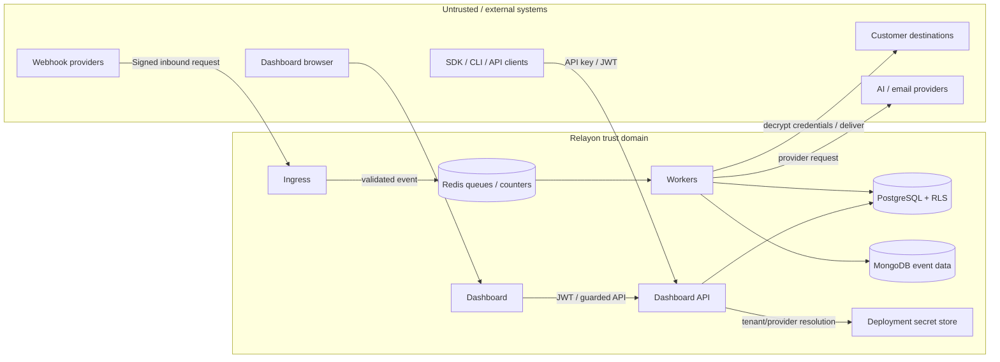
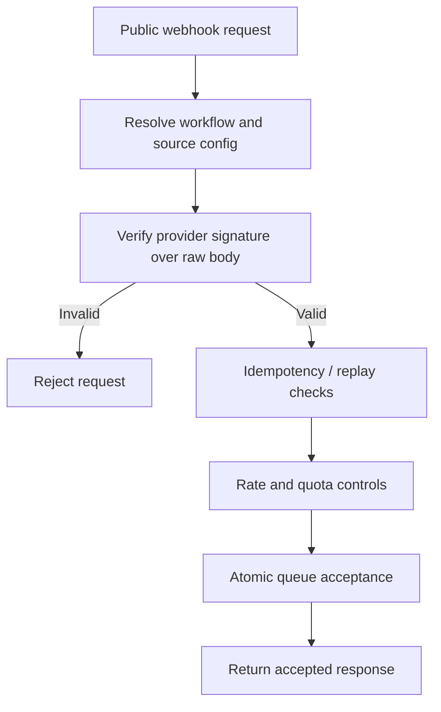

# Relayon — Security Architecture & Threat Model

> **Security architecture, trust boundaries, tenant isolation, credential protection, abuse resistance, and operational response for Relayon.**
>
> **Documentation baseline:** `v3.7.0`  
> **Audited source snapshot:** `main` at `f4dd930eafd2ab61381bc1c049bb6cdbb7480235`  
> **Snapshot date:** 24 November 2026  
> **Repository:** [`zainshah3464/relayon`](https://github.com/zainshah3464/relayon)  
> **Status:** Source-informed engineering documentation — not a security certification or penetration-test report.

This document describes security mechanisms found in the audited source snapshot. A control is not considered deployed merely because its code or configuration exists: production assurance also depends on environment configuration, database grants, migrations, network policy, provider settings, and operational procedures.

---

## Contents

- [1. Security posture and scope](#1-security-posture-and-scope)
- [2. System context and trust boundaries](#2-system-context-and-trust-boundaries)
- [3. Threat model](#3-threat-model)
- [4. Identity and authentication](#4-identity-and-authentication)
- [5. Authorization and tenant isolation](#5-authorization-and-tenant-isolation)
- [6. Inbound webhook security](#6-inbound-webhook-security)
- [7. Credential encryption and key management](#7-credential-encryption-and-key-management)
- [8. API keys and machine access](#8-api-keys-and-machine-access)
- [9. External adapters and execution isolation](#9-external-adapters-and-execution-isolation)
- [10. AI, RAG, and BYOK security considerations](#10-ai-rag-and-byok-security-considerations)
- [11. Queueing, delivery, replay, and idempotency](#11-queueing-delivery-replay-and-idempotency)
- [12. Input validation and application hardening](#12-input-validation-and-application-hardening)
- [13. Rate limits, quotas, and availability](#13-rate-limits-quotas-and-availability)
- [14. Outbound webhooks and signing](#14-outbound-webhooks-and-signing)
- [15. Auditability, logging, and privacy](#15-auditability-logging-and-privacy)
- [16. Secrets and deployment operations](#16-secrets-and-deployment-operations)
- [17. Security verification and CI](#17-security-verification-and-ci)
- [18. Known limitations and explicit non-guarantees](#18-known-limitations-and-explicit-non-guarantees)
- [19. Incident response playbooks](#19-incident-response-playbooks)
- [20. Vulnerability disclosure](#20-vulnerability-disclosure)
- [21. Source map and review checklist](#21-source-map-and-review-checklist)

---

## 1. Security posture and scope

Relayon is a multi-tenant webhook automation platform. It accepts events from external systems, validates and queues them, processes them in workers, and delivers data to configured destinations. It also exposes account, workflow, integration, billing, administration, AI, community, and developer-tooling capabilities.

The security design therefore has to protect more than an HTTP API:

1. **Tenant confidentiality:** one tenant must not read or mutate another tenant's data.
2. **Credential confidentiality:** source signing secrets, destination credentials, provider keys, API keys, and infrastructure secrets must not leak.
3. **Integrity:** signatures, authorization decisions, workflow configuration, event state, and delivery state must not be forgeable across trust boundaries.
4. **Availability:** public webhook intake, AI/provider calls, queues, schedules, and destination delivery must resist abuse and recover from failures.
5. **Operational accountability:** security-relevant actions and failures must be diagnosable without turning logs into a secret-exfiltration channel.

### 1.1 Evidence and wording policy

This document distinguishes the following:

| Wording | Meaning |
|---|---|
| **Implemented in source** | The audited source contains the mechanism. This does not prove production configuration. |
| **CI-verified** | The repository's CI workflow executes a corresponding automated test/job. |
| **Configuration-dependent** | The control only works when deployment secrets, database roles, migrations, or provider settings are correct. |
| **Not established by this audit** | The audited files do not provide enough evidence to claim the control. |
| **Not implemented / known gap** | The audited source does not implement the claimed protection. |

The source snapshot is pinned so that future code changes can be reviewed against a stable reference. The `v3.7.0` tag is the latest version tag in the audit; the final `main` snapshot includes two subsequent commits (brand refresh and a TypeScript declaration fix). Those commits do not create a new semantic version.

### 1.2 Security is not a certification

This document is not evidence of SOC 2, ISO 27001, PCI DSS, HIPAA, or GDPR certification. Passing CI is not equivalent to an independent penetration test, a formal cryptographic review, or a production configuration audit.

---

## 2. System context and trust boundaries

Relayon is composed of separately deployed services and supporting stores. The exact deployment topology can vary between the hosted Vercel setup and the self-hosted Docker Compose setup.



### 2.1 Trust boundaries

| Boundary | Untrusted input | Primary control |
|---|---|---|
| Provider → Ingress | Raw body, headers, event identifiers, timing | Source-specific signature verification, timestamp checks where supported, idempotency and rate controls |
| Browser/client → API | Credentials, DTOs, resource IDs, query parameters | JWT/API-key guards, DTO validation, tenant context, ownership checks |
| Cron/operator → internal routes | Internal operation request | `X-Cron-Secret`, fail-closed guard |
| API → PostgreSQL | Tenant-scoped reads/writes | `withTenant()` transaction context and PostgreSQL RLS |
| API/Workers → encrypted configuration | Ciphertext and key identifiers | AES-256-GCM envelope, tenant-derived key, keyring |
| Worker → destination/provider | Payload, URL, credentials, provider response | Adapter contract, credential resolution, TLS, bounded execution where implemented |
| External adapter → worker process | Third-party adapter code | Manifest validation, worker-thread execution, resource limits and timeout |

### 2.2 Service responsibilities

- **Dashboard:** user-facing interface. It is not an authorization boundary; the API must enforce all permissions independently.
- **Dashboard API:** identity, tenant configuration, workflows, destinations, billing, integrations, analytics, administration, and related application APIs.
- **Ingress:** public webhook intake and capture endpoints. It verifies provider signatures before accepting a webhook into the processing path.
- **Workers:** asynchronous processing, transformations, routing, schedules, delivery, replay, and adapter execution.
- **PostgreSQL:** relational system of record, including tenant-aware data and RLS policies.
- **MongoDB:** event/payload-oriented data store. Do not assume PostgreSQL RLS automatically protects MongoDB documents.
- **Redis:** queueing, counters, locks, and transient coordination. Redis access and network isolation remain deployment responsibilities.

---

## 3. Threat model

Relayon assumes that internet-facing inputs are attacker-controlled. The system must not trust a client-supplied tenant ID, source IP, event ID, URL, provider response, or serialized object merely because it is syntactically valid.

### 3.1 Assets

| Priority | Asset | Security objective |
|---:|---|---|
| 1 | Tenant records, workflows, events, deliveries | Confidentiality and isolation |
| 2 | Webhook signing secrets and destination credentials | Confidentiality and integrity |
| 3 | JWT/refresh tokens and API keys | Authentication integrity and revocation |
| 4 | Provider BYOK keys and platform API keys | Confidentiality and controlled use |
| 5 | Queue state, idempotency records, schedules | Integrity and availability |
| 6 | Billing, quota, and administrative state | Integrity and authorization |
| 7 | Logs, telemetry, and tracking data | Privacy and controlled retention |
| 8 | Infrastructure secrets and encryption keyring | Confidentiality and platform integrity |

### 3.2 Adversaries

- Anonymous internet attacker sending forged or replayed webhooks.
- Authenticated tenant attempting horizontal or vertical privilege escalation.
- Stolen API-key or refresh-token holder.
- Malicious or compromised destination endpoint.
- Malicious external adapter author.
- Malicious tenant attempting prompt injection or data exfiltration through AI features.
- Insider or attacker with read-only database access.
- Attacker with application-process, deployment, or secret-store access.

### 3.3 Representative abuse cases

| Threat | Expected defense | Residual risk |
|---|---|---|
| Cross-tenant resource ID guessing | Tenant-scoped queries and RLS | Tables outside the RLS policy set need explicit application-level scoping |
| Forged webhook | HMAC/signature verification over provider-defined content | Providers without signed timestamps rely on event deduplication for replay control |
| Replay of valid webhook | Timestamp tolerance where available and idempotency | At-least-once processing means downstream idempotency is still required |
| Stolen API key | Hash-at-rest, expiry, revocation, scopes | Key compromise remains usable until revoked/expired |
| Database dump | Encrypted credential fields and hashed tokens/keys | Event payloads and non-secret metadata may remain readable |
| Malicious adapter | Manifest validation, worker thread, timeout/resource limits | Worker thread is not a hardened OS/container security boundary |
| SSRF through destination or adapter URL | URL validation and network policy must be applied at the relevant call site | The sandbox fetch shim only enforces HTTPS scheme; it is not a complete SSRF defense |
| Prompt injection | Treat retrieved content and event payloads as untrusted; constrain tools and tenant scope | Model output is probabilistic and must not be treated as authorization |
| Cron secret compromise | Rotate shared secret and redeploy | A valid secret can invoke protected internal operations |
| Encryption key compromise | Keyring rotation plus destination credential rotation | An attacker with active process/key access may decrypt data during compromise |

### 3.4 Security invariants

1. A tenant identifier is derived from verified identity or trusted internal context, not accepted as authority from a request body.
2. Resource ownership is checked at the service/data-access boundary.
3. A missing or invalid authentication secret must fail closed.
4. Webhook signature verification occurs before queue acceptance.
5. Ciphertext must never be returned as a substitute for redaction.
6. A validation/dry-run operation must not perform a real destination write.
7. A worker retry must not be described as exactly-once delivery.
8. AI output must never grant permissions or bypass API authorization.

---

## 4. Identity and authentication

The audited source contains local email/password authentication, Google/GitHub OAuth integration, email verification, password reset, JWT access tokens, and opaque refresh tokens.

### 4.1 Local credentials

- Passwords are hashed with `bcryptjs` using a work factor of **12** in the audited `AuthService`.
- Login rejects unknown users, OAuth-only accounts without a password hash, invalid passwords, and users whose email is not verified.
- Local signup creates the user with `emailVerified: false` and triggers verification email delivery asynchronously.
- Password reset hashes the new password with the same bcrypt work factor and sends a password-changed notification.

**Operational requirements:** use HTTPS for all credential exchange; configure email delivery securely; protect verification/reset tokens; monitor repeated authentication failures; and ensure secrets are not logged.

### 4.2 OAuth

The audited auth service supports Google and GitHub OAuth profiles. It resolves an existing user by provider identity, can link a provider to an existing email account, and creates a tenant for a new OAuth identity.

OAuth security depends on the correctness of the provider strategy/controller configuration, callback URL allowlists, state/CSRF validation, provider client secrets, and account-linking behavior. Those deployment and callback settings must be reviewed independently; the existence of OAuth service methods alone does not prove every provider-side setting is safe.

### 4.3 Access tokens

- JWT signing uses the configured `JWT_SECRET`.
- The access-token expiry is configurable through `JWT_EXPIRES_IN`; the source default is `15m`.
- The payload includes user subject, email, role, and tenant ID.
- Protected controllers validate JWTs through their guards.

Do not put credentials, destination secrets, or sensitive event payloads in JWT claims. Treat the JWT as a bearer credential: possession grants the authority encoded by the relevant guard and controller.

### 4.4 Refresh tokens

- Refresh tokens are generated from 48 random bytes and encoded as base64url.
- Only a SHA-256 hash is stored in PostgreSQL.
- Expiry is configurable with `JWT_REFRESH_EXPIRES_IN`; the source default is `7d`.
- Refresh revokes the presented token and issues a replacement.
- Logout revokes matching active refresh-token records.

The refresh-token lookup occurs before the tenant is known, using the explicit cross-tenant database helper; the subsequent mutation uses the resolved tenant context.

**Important implementation boundary:** the service returns an access token and refresh token to its controller. Cookie flags, browser storage, CSRF behavior, and transport policy are controller/client responsibilities and must be verified at those layers. Do not infer `httpOnly`, `Secure`, or `SameSite` behavior from the service alone.

### 4.5 Session and account limitations

The audited material establishes refresh-token rotation and logout revocation. It does not establish a complete user-facing session inventory/revocation console, MFA/TOTP, hardware-key authentication, or enterprise SSO policy. These must not be advertised as current protections without separate implementation evidence.

---

## 5. Authorization and tenant isolation

Tenant isolation is enforced through multiple application and database mechanisms. These mechanisms are complementary; none should be treated as a replacement for the others.

### 5.1 Application tenant context

`PrismaService.withTenant(tenantId, fn)` opens a transaction and executes:

```sql
SELECT set_config('app.tenant_id', '<tenant-id>', true);
```

The third argument makes the setting transaction-local. Queries in the callback execute using that tenant context.

For tenant-owned data, use the tenant-aware helper and include the tenant in resource predicates where applicable:

```ts
await prisma.withTenant(tenantId, (tx) =>
  tx.workflow.findFirst({
    where: { id: workflowId, tenantId },
  }),
);
```

The `tenantId` passed to this helper must come from verified identity or trusted internal processing, never directly from an untrusted request field.

### 5.2 PostgreSQL Row-Level Security

The audited SQL policy file enables and forces RLS on these ten tables:

- `tenants`
- `users`
- `refresh_tokens`
- `workflows`
- `destinations`
- `workflow_schedules`
- `api_keys`
- `usage_counters`
- `workflow_versions`
- `api_key_rotations`

The tenant policies compare each row's tenant key to `current_setting('app.tenant_id', true)` and apply both `USING` and `WITH CHECK`.

```sql
USING (tenant_id = current_setting('app.tenant_id', true))
WITH CHECK (tenant_id = current_setting('app.tenant_id', true))
```

The `tenants` table uses its `id` as the tenant key.

**Important scope qualification:** this policy file explicitly covers the ten tables listed above. It is incorrect to claim that every PostgreSQL table in the complete schema is protected by these exact RLS policies. Other tables must be reviewed for their own tenant predicates, relation constraints, and access paths.

RLS is only effective when:
- the migration/policy script has been applied to the target database;
- the runtime database role does not unintentionally bypass RLS;
- all tenant queries set the transaction-local tenant context;
- privileged cross-tenant access is tightly controlled;
- tests exercise both allowed and denied access paths.

### 5.3 Privileged cross-tenant access

`PrismaService.withoutTenant()` uses a transaction-scoped `SET LOCAL ROLE relayon_system`. The SQL policy script creates `relayon_system` as `NOLOGIN BYPASSRLS` and grants it table/sequence access.

The helper is intended for operations where the tenant is not yet known or where a system-wide task is required, including:
- signup lookups/tenant creation;
- API-key prefix lookup before the key's tenant is known;
- refresh-token hash lookup before the tenant is known;
- system schedule processing.

This is a highly privileged path. Any new use must be reviewed for explicit ownership predicates and must not accept a user-controlled tenant filter as proof of authorization. The `relayon_system` role and the ability to assume it should be treated as security-critical database privileges.

### 5.4 Guard and scope model

The current API uses more than one guard class. A route's actual controller guard is authoritative.

- JWT-only controllers require a user JWT.
- `JwtOrApiKeyGuard` accepts a JWT or an API key.
- API-key requests are checked against the route's required scope metadata.
- JWT sessions accepted by the hybrid guard bypass API-key scope checks and receive the session's tenant authority.
- Internal cron routes use `X-Cron-Secret`.
- Provider-facing webhook routes use provider signature verification.

A scope being valid in the API-key schema does **not** prove a route accepts API keys. For example, the audited API reference identifies destination scopes as valid key metadata while the destinations controller remains JWT-guarded. Keep the API reference aligned with actual controller guards.

### 5.5 Platform administration

Relayon includes platform-level administration and a `isSuperAdmin` identity attribute. Tenant roles and platform-admin privileges are separate authorization dimensions. Every platform-admin route must enforce the platform privilege on the server; hiding a dashboard navigation item is not authorization.

Review all administrative endpoints for:
- server-side role checks;
- tenant boundary transitions;
- explicit audit events;
- least-privilege data returned to the operator;
- protection against mass assignment of privileged fields.

### 5.6 Non-PostgreSQL stores

PostgreSQL RLS does not protect MongoDB, Redis, object storage, logs, or provider APIs. For each such store, enforce tenant partitioning/keys, access control, network isolation, TTL/retention, and service-level ownership checks independently.

---

## 6. Inbound webhook security

Inbound webhook traffic is public by design. The endpoint must assume that every body, header, timestamp, and event identifier is attacker-controlled until verified.

### 6.1 Verification order

The ingress route resolves the workflow configuration before signature verification because the workflow contains the source type and signing configuration. The signature middleware then verifies the request using the raw body and request headers.

The security-sensitive sequence is:



Signature verification must remain ahead of idempotency storage and queue acceptance. Invalid requests must not be allowed to consume durable processing capacity.

### 6.2 Provider-specific signatures

The verifier must follow each provider's exact signing contract. Typical patterns include:
- Stripe: timestamp plus raw body, as encoded in `Stripe-Signature`.
- GitHub: HMAC over the raw body using `X-Hub-Signature-256`.
- Shopify: HMAC over the raw body using `X-Shopify-Hmac-Sha256`.
- Slack: version, timestamp, and raw body using `X-Slack-Signature`.
- Generic sources: configured generic signature contract.

The raw request bytes are security-relevant. Parsing and re-serializing JSON before signature verification can change the signed representation and must not be substituted for the original raw body.

### 6.3 Timestamp and replay controls

Where the provider supplies a signed timestamp, enforce a bounded tolerance. The legacy security design documents a 300-second default for supported timestamp-based signatures; the current ingress configuration and verifier remain authoritative.

For sources without a signed timestamp, replay protection depends on idempotency/event identifiers and the configured retention window. A body-hash fallback can help when no stable event ID exists, but identical legitimate payloads may require source-specific handling.

**Do not claim universal replay prevention.** A valid signed request can be replayed if the source does not provide a timestamp and the event is not recognized by the idempotency mechanism.

### 6.4 Secret handling

Workflow signing secrets are encrypted in PostgreSQL using the credential-encryption subsystem. Ingress must decrypt only the configuration it needs for verification and must never return the secret or ciphertext to the caller.

### 6.5 Failure behavior

- Missing workflow or missing signing configuration must fail closed.
- Invalid signatures must not enqueue work.
- Signature errors must not log the secret or full authorization headers.
- Provider error responses should avoid exposing internal workflow existence or secret state beyond what the endpoint contract requires.

---

## 7. Credential encryption and key management

Relayon's credential-encryption subsystem uses authenticated encryption and tenant-derived keys. This protects selected credentials stored in PostgreSQL; it does not encrypt every piece of application data or provide end-to-end encryption.

### 7.1 Cryptographic construction

The audited `crypto-box.ts` implementation uses:
- **AES-256-GCM** for authenticated encryption;
- **HKDF-SHA-256** to derive tenant-specific encryption keys from a master key;
- a random 12-byte IV/nonce for GCM;
- a 16-byte authentication tag;
- key IDs (`kid`) in the current envelope format.

Conceptually:

```text
master key + tenant ID + purpose/context
                 |
               HKDF
                 |
          tenant-derived key
                 |
plaintext -- AES-256-GCM --> authenticated ciphertext
```

Tenant derivation provides cryptographic separation between tenants when the same master keyring is used. It does not protect against compromise of the master keyring or a process that can decrypt credentials.

### 7.2 Envelope formats

The current keyring envelope is:

```text
enc:v2:<kid>:<base64url-iv>:<base64url-auth-tag>:<base64url-ciphertext>
```

The legacy v1 envelope remains readable for compatibility:

```text
enc:v1:<base64url-iv>:<base64url-auth-tag>:<base64url-ciphertext>
```

The v2 format identifies the key used for encryption. Legacy v1 data has no key ID and is decrypted by trying available keyring entries. New writes should use the current v2 keyring format.

### 7.3 Keyring configuration

The keyring is configured through `CONNECTOR_ENCRYPTION_KEYS` in the audited implementation. Entries contain a key ID and a 64-hex-character (32-byte) key. The first configured entry is the current encryption key; retained entries allow decryption of older envelopes.

Example shape only — replace all values with independently generated secrets:

```env
CONNECTOR_ENCRYPTION_KEYS=current-kid:<64-hex-character-key>,previous-kid:<64-hex-character-key>
```

The same compatible keyring must be available to every service that encrypts or decrypts the relevant fields. A mismatch between API, Ingress, and Workers can cause decryption failures and failed webhook verification or deliveries.

Never:
- commit real keys to source control;
- reuse example/CI keys in production;
- log key material;
- put the keyring in client-side code;
- remove an old key before all data encrypted under it has been re-encrypted and verified.

### 7.4 Encrypted fields and redaction

The implementation has a `SECRET_CONFIG_KEYS` allowlist and recursively encrypts matching non-empty string values in configuration objects. It also exposes `redactConfig()` to replace recognized secret values with a fixed mask in API-facing configuration.

This is **allowlist-based field encryption**, not blanket encryption of every JSON value. The presence of a key in a config object does not guarantee it is protected unless it is included in the current secret-key set or handled by a separate encryption path.

A mask is a presentation value, not a credential. Update flows must preserve stored ciphertext when the client sends the mask back rather than overwriting the real secret with the mask.

### 7.5 Key rotation procedure

Use a staged rotation so old ciphertext remains decryptable during migration:

1. Generate a new independent 32-byte key using a cryptographically secure random generator.
2. Add the new key as the first entry in `CONNECTOR_ENCRYPTION_KEYS`, retaining the old key.
3. Deploy the same keyring to every service that needs it.
4. Run the repository's encryption-rotation script in the documented operational environment.
5. Verify the migration completed and inspect logs for unknown-key/decryption errors.
6. Keep the old key available until all required data and backups have passed the retention/restore policy.
7. Remove the old key only after confirming no live data still requires it and a rollback plan exists.

A rotation script is a data migration. Back up the database first, run it with least-privilege access, and verify counts and representative decryptions before retiring an old key.

### 7.6 Protection boundaries

**Helps protect against:**
- a database-only read or dump exposing selected credential fields as immediately usable plaintext;
- backups containing those encrypted credential fields;
- read-only database access without access to the keyring.

**Does not protect against:**
- compromise of an API/Ingress/Workers process that has access to the keyring;
- an operator or attacker who can read deployment secrets;
- plaintext exposure at the moment a credential is used;
- plaintext webhook payloads or event data unless a separate mechanism encrypts them;
- credentials accidentally copied into logs, traces, crash reports, or third-party systems.

---

## 8. API keys and machine access

API keys are bearer credentials for programmatic access. They must be treated like passwords: display once, store safely, scope narrowly, rotate, and revoke when exposed.

### 8.1 Format and entropy

The audited format is:

```text
rlk_<live|test>_<8-hex-prefix>_<48-hex-secret>
```

The secret portion is generated from 24 cryptographically random bytes. The prefix supports indexed lookup without storing the raw key.

### 8.2 Storage and verification

- The raw key is returned at creation and is not stored as plaintext.
- The database stores a SHA-256 hash of `API_KEY_PEPPER + ":" + rawKey`.
- Verification looks up the record by prefix, rejects revoked/expired keys, and compares hashes with `timingSafeEqual`.
- `lastUsedAt` is updated asynchronously after successful verification.
- The default expiry is 90 days unless the key is created with `neverExpires`.

Because the key has high random entropy, a fast cryptographic hash is appropriate for lookup verification; this is not the same threat model as hashing a human-selected password.

### 8.3 Critical production configuration

The audited source contains a development fallback:

```ts
const PEPPER =
  process.env['API_KEY_PEPPER'] ?? 'relayon-dev-pepper-change-in-prod';
```

**Production must explicitly set a strong, unique `API_KEY_PEPPER`.** Do not rely on the fallback. A production deployment that omits the variable uses a predictable development value and weakens the database-leak protection for API-key hashes.

The application should ideally fail startup in production when the pepper is missing or below the required strength. Until that behavior is enforced in code, deployment validation is mandatory.

Rotating the pepper changes the hash derivation and can invalidate existing API keys. Treat pepper rotation as a coordinated credential migration, not a routine environment-variable edit.

### 8.4 Scopes and route coverage

The key schema supports the following scope names in the audited API contract:

- `events:read`
- `workflows:read`
- `workflows:write`
- `destinations:read`
- `destinations:write`
- `dlq:read`
- `dlq:write`
- `analytics:read`

A scope only grants access when the target controller uses the API-key-capable guard and the route declares the corresponding required scope. Some controllers remain JWT-only. In particular, the audited destinations controller uses `JwtAuthGuard`; destination scope strings in a key do not independently make those routes API-key accessible.

Always inspect the controller guard and route decorator before documenting API-key support.

### 8.5 Rotation and revocation

- Rotation creates a replacement key with the prior key's scopes and environment.
- The old key receives a grace period of up to 24 hours, capped by its existing expiry.
- Rotation lineage is recorded in `api_key_rotations`.
- Explicit revocation sets `revokedAt`; subsequent verification rejects the key.

Use the shortest scope set and expiry that the integration can tolerate. Revoke immediately when a key is exposed; do not wait for the grace period.

---

## 9. External adapters and execution isolation

Relayon supports external/community adapter loading. Adapter manifests are parsed with Zod and validate fields such as schema version, adapter type, semantic version, trust declaration, entrypoint name, and configuration descriptors.

### 9.1 Manifest and path checks

The audited loader:
- parses `manifest.json`;
- validates it against `ManifestSchema`;
- resolves the entrypoint relative to the adapter directory;
- rejects entrypoints that escape the adapter directory;
- verifies that the entrypoint is a file;
- rejects duplicate adapter types;
- requires external adapters to declare `trust="sandboxed"` at execution time.

### 9.2 Worker-thread execution

The audited sandbox runner executes the adapter in a Node.js worker thread with:
- a 5-second execution timeout;
- an additional parent-side kill deadline;
- worker resource limits for old/young heap generations and stack size;
- a restricted `fetch` shim that rejects non-HTTPS URL strings and proxies HTTP requests through the parent worker.

### 9.3 Do not overstate the sandbox

A Node.js worker thread is an execution-isolation and resource-control mechanism, **not a hardened operating-system security boundary**. It is not equivalent to a container, VM, seccomp profile, separate user, or network namespace.

The current fetch shim's HTTPS check is not a complete SSRF defense. It does not, by itself, establish:
- destination hostname allowlisting;
- private/link-local/loopback IP blocking;
- DNS rebinding protection;
- redirect re-validation;
- cloud metadata endpoint protection;
- egress firewall enforcement.

Treat external adapters as untrusted code. For hostile multi-tenant workloads, run them in a separately hardened process/container with a non-privileged identity, read-only filesystem where possible, strict CPU/memory/time limits, explicit egress allowlists, and no access to platform secrets beyond the minimum required.

Do not pass database credentials, encryption master keys, process environment, or unrelated tenant secrets into an adapter context.

---

## 10. AI, RAG, and BYOK security considerations

Relayon includes AI assistant and retrieval/tooling capabilities, plus tenant BYOK provider keys. AI introduces a distinct trust boundary: event payloads, user prompts, retrieved knowledge, and provider output are untrusted content.

### 10.1 Prompt injection

A webhook payload, document, community post, workflow description, or retrieved text may contain instructions intended to manipulate the model. Such content must be treated as data, not as system or developer authority.

Required design rules:
- Never let model output directly decide tenant identity or authorization.
- Re-check tenant ownership and permissions inside every tool/service call.
- Validate tool arguments with server-side schemas.
- Use explicit allowlists for tools and operations.
- Do not expose secrets or unrelated tenant records in the model context.
- Keep provider credentials outside prompts and tool results.
- Require user confirmation for destructive or externally visible actions where appropriate.

### 10.2 Retrieval boundaries

The audited RAG implementation uses PostgreSQL full-text search/fallback matching, not vector embeddings. The `knowledge_chunks` query includes shared knowledge and tenant-specific knowledge conditions. Retrieval filters are not an authorization substitute: every returned chunk and every subsequent tool action must remain tenant-scoped.

### 10.3 BYOK provider keys

The provider resolver:
1. looks for an active tenant integration key;
2. decrypts the tenant key using the tenant context;
3. falls back to the configured platform provider key when no usable tenant key is resolved;
4. caches the resolved provider result for 60 seconds.

Supported provider identifiers in the audited resolver include Groq, OpenAI, Anthropic, and Resend.

The fallback behavior is a product/configuration choice. Make the selected provider/key source observable to authorized operators without exposing the key itself. Invalidate cached entries when integration credentials change or are revoked.

### 10.4 Provider data handling

When using hosted AI/email providers, data sent to those providers leaves Relayon's infrastructure. Review provider retention, training, region, and contractual settings separately. Do not claim that webhook payloads remain exclusively inside Relayon when a workflow or AI feature sends them to a third party.

---

## 11. Queueing, delivery, replay, and idempotency

Relayon's webhook pipeline is asynchronous. Queue acceptance, processing, and destination delivery are separate events and failure domains.

### 11.1 Delivery guarantee

The system should be documented as **at-least-once**, not exactly-once. A worker can complete a destination write and fail before acknowledging its queue state; retries may then repeat the external side effect.

For destinations that support idempotency keys, use them. For destinations that do not, consumers should design for duplicate events and operators should understand replay consequences.

### 11.2 Idempotency

Ingress uses event identity/deduplication mechanisms to prevent repeated source events from creating unlimited duplicate work. The exact idempotency key, TTL, and fallback behavior are source/path-specific and must be read from the current ingress implementation before being promised as a universal guarantee.

### 11.3 Dead-letter queue

The DLQ is an operational recovery mechanism, not a guarantee that every failure is harmless. Before replay:
- inspect the original event and failure reason;
- correct the destination/configuration issue;
- understand whether the destination may already have accepted the previous attempt;
- replay only the intended event/delivery;
- monitor the resulting attempt and downstream state.

### 11.4 Transactional outbox

The API outbox service creates an outbox event and supports receiving the caller's transaction client. When passed the business transaction, the outbox record can be committed atomically with the associated business write. The service sets a seven-day event-retention expiry.

This protects the database-write-to-event-record boundary when callers use the shared transaction correctly. It does not create exactly-once delivery to a customer's endpoint; downstream retries and idempotency still matter.

---

## 12. Input validation and application hardening

### 12.1 DTO validation

The Dashboard API uses Nest validation with:
- `whitelist: true`;
- `forbidNonWhitelisted: true`;
- transformation enabled.

Unknown DTO properties are rejected rather than silently accepted. Keep DTOs narrow, validate nested objects, and avoid mass assignment of fields such as tenant IDs, ownership, billing state, or administrative flags.

### 12.2 Configuration validation

Service configuration should be validated at startup. Security-critical settings include JWT secrets, cron secrets, encryption keyring, API-key pepper, database URLs, Redis connectivity, and provider credentials.

Fail closed when a required authentication secret is absent or malformed. Do not ship development defaults into production.

### 12.3 URL and SSRF validation

Any feature that accepts a URL and causes a server-side request is an SSRF boundary. This includes HTTP destinations, external adapters, provider validation, webhook destinations, and integration callbacks.

A robust policy should:
- allow only required schemes (normally HTTPS);
- reject loopback, private, link-local, multicast, and reserved address ranges;
- resolve and validate DNS results at connection time;
- revalidate redirect targets;
- defend against DNS rebinding;
- block cloud metadata endpoints;
- enforce egress restrictions at the network layer;
- set connection, response, and total timeouts;
- cap response size and avoid returning raw upstream bodies to clients.

Do not interpret a scheme check alone as SSRF protection.

### 12.4 Payload and parser limits

Apply bounded request-body sizes, timeouts, pagination limits, JSON nesting/complexity limits, and response-size limits. The legacy v1.5 document's numerical body limits must not be copied into a v3.7.0 guarantee unless the current service bootstrap/configuration is rechecked.

### 12.5 Safe execution

The audited architecture uses JSONata for workflow transformation and does not require arbitrary JavaScript evaluation for normal transformations. Keep user-authored expressions constrained by the transform engine's supported functions and runtime limits. Never introduce `eval`, `new Function`, or an unrestricted Node `vm` execution path for tenant-authored content.

---

## 13. Rate limits, quotas, and availability

Rate limiting and quotas protect different resources:

- **Rate limits** bound request frequency over a time window.
- **Quotas** bound usage over a billing or product-defined period.
- **Concurrency controls/locks** prevent overlapping internal work.
- **Circuit breakers/retries** manage dependency failure and recovery.

Relayon has rate/usage controls across webhook intake, AI/provider usage, and tenant quota behavior. Exact limits may vary by route, plan, environment, or configuration. Do not publish a single global rate number as though it applies to every API route.

### 13.1 Operational controls

- Apply per-tenant and per-credential limits where possible.
- Bound AI/provider calls and enforce provider-specific timeouts.
- Keep internal cron routes protected even if they are not subject to public-user rate limits.
- Monitor queue depth, retry counts, DLQ growth, provider latency, and quota exhaustion.
- Avoid unbounded retries and unbounded response-body buffering.
- Ensure Redis and database endpoints are not exposed publicly.

### 13.2 Cron secret

The audited `CronSecretGuard`:
- reads `X-Cron-Secret`;
- fails closed if `CRON_SECRET` is missing or shorter than 16 characters;
- rejects missing/non-string values;
- checks equal-length values using `timingSafeEqual`.

The secret is a shared operational credential. Rotate it after suspected disclosure and update every service/caller that uses it.

---

## 14. Outbound webhooks and signing

Relayon can send notifications to customer-configured webhook endpoints. This is separate from receiving provider webhooks.

The audited Standard Webhooks helper:
- generates `whsec_` secrets from random bytes;
- signs `webhook-id.webhook-timestamp.rawBody` using HMAC-SHA256;
- emits a `v1,<base64-signature>` value;
- verifies timestamps against a 300-second tolerance;
- uses timing-safe comparison for candidate signatures;
- supports multiple space-separated signature candidates for rotation compatibility.

Consumers should verify the signature against the exact raw body, validate timestamp freshness, and deduplicate by webhook ID. Never trust a notification solely because it arrived over HTTPS.

---

## 15. Auditability, logging, and privacy

### 15.1 Structured operational logs

Logs should support correlation across ingress, queue processing, workers, and delivery attempts. Use request/event/correlation identifiers where available.

Never log:
- raw API keys;
- passwords or password-reset/verification tokens;
- JWTs or refresh tokens;
- encryption keys or provider API keys;
- webhook signing secrets;
- full destination configuration containing credentials;
- authorization headers;
- raw event payloads unless explicitly required, access-controlled, and retention-limited.

Prefer redacted metadata: tenant/resource IDs where appropriate, event type, adapter type, status, attempt number, latency, and stable error codes.

### 15.2 Audit trail versus application logs

Application logs are not automatically a durable security audit trail. The audited API-key rotation flow writes rotation lineage to `api_key_rotations`, and the application has operational logging. Do not claim that every privileged action is stored in a comprehensive immutable audit table unless that table, write paths, retention, and access controls are verified.

For a production audit trail, record actor, action, target, timestamp, tenant, outcome, request/correlation ID, and a safe before/after representation. Never store secrets in audit diffs.

### 15.3 Privacy and tracking

Tracking, presence, analytics, and community features create additional personal-data surfaces. Apply purpose limitation, least privilege, retention limits, and access controls. Hashing an IP address is pseudonymization, not anonymization, especially when a stable salt is used.

---

## 16. Secrets and deployment operations

### 16.1 Secret inventory

The exact environment-variable set depends on enabled features and deployment mode. Security-sensitive examples include:

| Secret/configuration | Purpose | Handling |
|---|---|---|
| `DATABASE_URL`, `DIRECT_DATABASE_URL` | PostgreSQL access | Secret store only; least-privilege DB roles |
| `MONGODB_URI` | MongoDB access | Secret store only; network-restricted |
| Redis connection URL | Queue/counter access | Secret store only; TLS/network controls |
| `JWT_SECRET` | Access-token signing | Strong random value; rotate with planned session invalidation |
| `JWT_REFRESH_EXPIRES_IN` | Refresh-token lifetime | Configuration, not secret |
| `CRON_SECRET` | Internal route authentication | Strong random value; shared only with required callers |
| `CONNECTOR_ENCRYPTION_KEYS` | Credential encryption keyring | Highest sensitivity; same compatible keyring on required services |
| `API_KEY_PEPPER` | API-key hash pepper | Must be explicitly set in production; never rely on source fallback |
| `GROQ_API_KEY`, `OPENAI_API_KEY`, `ANTHROPIC_API_KEY`, `RESEND_API_KEY` | Platform provider credentials | Only configure on services that need them |
| OAuth client secrets | Google/GitHub login | Secret store; restrict callback URLs |
| Billing provider secrets | Checkout/webhook verification | Secret store; test/live separation |
| `IP_HASH_SALT` | Pseudonymous IP hashing | Secret store; treat output as personal/pseudonymous data |

This table is representative, not a complete deployment manifest. Use the current environment schema and deployment guide for the authoritative required/optional list.

### 16.2 Environment separation

Maintain separate development, CI, staging, and production credentials. Never reuse:
- CI encryption keys;
- dummy provider credentials;
- local JWT secrets;
- development API-key pepper;
- test billing secrets

in production.

### 16.3 Database operations

- Apply migrations and RLS policies deliberately.
- Verify the runtime database role and `relayon_system` grants.
- Restrict direct database access to trusted operators/services.
- Encrypt backups and test restoration.
- Monitor schema/policy drift between environments.
- Avoid granting broad superuser or `BYPASSRLS` capability to application roles except for the explicitly reviewed system-role mechanism.

### 16.4 Deployment operations

For Vercel or Docker Compose:
- terminate TLS correctly;
- keep internal service ports private;
- use a secret manager/environment secret facility;
- restrict outbound network access where practical;
- configure health checks and resource limits;
- persist database/queue data appropriately;
- verify backups and restore procedures;
- rotate secrets after access changes or suspected exposure.

The presence of Dockerfiles or deployment configuration does not prove a particular production deployment is hardened.

---

## 17. Security verification and CI

The audited repository includes a dedicated GitHub Actions Tests workflow. At the audited snapshot it defines:

| Job | What it exercises |
|---|---|
| Unit tests | Vitest coverage with PostgreSQL, Redis, and MongoDB services |
| Integration tests | Integration suite against service containers and applied migrations/RLS |
| RLS enforcement | Dedicated RLS integration test after applying RLS policies |
| Mutation testing | Critical-path mutation job on pull requests; configured `continue-on-error: true` |

The separate CI workflow runs Node 22 setup, dependency installation, Prisma/SDK generation, workspace typecheck, and builds for Dashboard, API, Ingress, and Workers.

### 17.1 What CI success means

A passing run demonstrates that the configured jobs passed for that commit and CI environment. It does not prove:
- production secrets are correct;
- production RLS policies are applied;
- live provider accounts are secure;
- every external adapter is safe;
- all attack paths have been tested;
- the application has passed an independent penetration test.

At the recorded audit snapshot, CI run **#39** and Tests run **#6** for HEAD `f4dd930e` were reported successful. The mutation job was skipped on the push because it is pull-request-only. This is historical evidence, not a guarantee about future commits or deployments.

### 17.2 Security regression checklist

Before merging a security-sensitive change, add or update tests for:

- unauthenticated access is rejected;
- expired/revoked credentials are rejected;
- missing cron secret fails closed;
- wrong webhook signature is rejected before queue acceptance;
- replayed event behavior is deterministic;
- Tenant A cannot read or mutate Tenant B's resources;
- RLS blocks cross-tenant reads and writes;
- privileged `withoutTenant()` access has explicit ownership constraints;
- secret values are encrypted at rest and redacted in API responses;
- wrong tenant/key ID/authentication tag fails decryption;
- API-key scope checks are applied only where intended;
- dry-run/validation paths do not write to destinations;
- external adapter timeout terminates execution;
- AI tools cannot cross tenant boundaries;
- logs do not contain credentials or raw bearer tokens.

---

## 18. Known limitations and explicit non-guarantees

The following are important limitations or areas where the audited source does not establish a stronger guarantee.

### 18.1 Not established as implemented

Do not advertise these as current security features without new source evidence:

- MFA/TOTP or hardware security-key authentication.
- Complete user-facing session inventory and remote session revocation UI.
- End-to-end encryption of webhook payloads.
- Universal encryption of all event data and all database columns.
- Universal RLS coverage across every PostgreSQL table.
- A hardened OS/container boundary for external adapter code.
- Complete SSRF protection based only on the external adapter HTTPS check.
- A comprehensive immutable audit log covering every privileged action.
- Formal SOC 2, ISO 27001, PCI DSS, HIPAA, or GDPR certification.
- Exactly-once destination delivery.

### 18.2 Concrete code-review findings

**API key pepper fallback:** `api-keys.service.ts` falls back to the literal `relayon-dev-pepper-change-in-prod` when `API_KEY_PEPPER` is absent. Production must explicitly configure a strong pepper. A follow-up hardening change should fail application startup in production when it is missing or weak.

**RLS coverage is explicit, not universal:** `policies.sql` applies RLS to ten named tables. Review every additional tenant-bearing table and every access path separately.

**Privileged system role:** `relayon_system` is created with `BYPASSRLS`. Access to this role and every `withoutTenant()` call are security-critical and deserve focused review.

**Worker-thread sandbox limitations:** external adapter execution uses a Node worker thread with resource limits, not a hardened OS sandbox. The HTTPS-only fetch shim is not a complete SSRF or egress policy.

**API-key scope/controller mismatch:** some scope names exist in the key DTO/schema even though their controller is JWT-only. Keep public documentation aligned with actual route guards.

**Configuration-dependent protection:** encryption, cron authentication, database RLS, OAuth, provider validation, and TLS all depend on production configuration. Source code cannot prove that a deployed environment has the correct values.

### 18.3 Security roadmap recommendations

These are recommendations, not claims about current implementation:

1. Fail startup in production if `API_KEY_PEPPER` is absent or uses a known development value.
2. Add a machine-generated RLS coverage inventory from the Prisma schema and SQL policy definitions.
3. Restrict the `relayon_system` role's membership/grants and add tests for every privileged helper call.
4. Move untrusted external adapters into a hardened process/container with explicit egress allowlists.
5. Centralize SSRF-safe URL resolution and redirect validation for every server-side HTTP client.
6. Add MFA and a user-facing session management/revocation interface.
7. Build a durable, access-controlled audit trail for privileged actions.
8. Add automated secret scanning, dependency vulnerability review, and container/image scanning to CI.
9. Add threat-model review and security regression tests for AI tool execution and prompt-injection boundaries.
10. Commission an independent penetration test before making external compliance/security certification claims.

---

## 19. Incident response playbooks

These are operational response procedures. Adapt them to the actual hosting provider and on-call model.

### 19.1 API key exposed

1. Identify the affected tenant/key ID and scope.
2. Revoke the key immediately.
3. Review API-key rotation history and available request logs.
4. Inspect events, workflows, DLQ, and destination changes made during the exposure window.
5. Issue a replacement key with the minimum scopes and expiry.
6. Notify the affected tenant according to the incident policy.

### 19.2 Destination credential or webhook secret exposed

1. Disable or rotate the credential at the destination provider first.
2. Update the Relayon workflow/destination configuration.
3. Confirm the new value is encrypted and the API response is masked.
4. Review delivery failures and suspicious destination activity.
5. Reprocess only after confirming the destination state and duplicate-write risk.

### 19.3 Encryption keyring compromise

1. Treat the incident as a credential compromise, not merely a database incident.
2. Restrict access to the affected runtime/deployment secret store.
3. Generate a new key and deploy a staged keyring.
4. Re-encrypt stored values using the rotation procedure.
5. Rotate/reissue credentials that may have been decrypted during the compromise.
6. Remove the compromised key only after migration and restore implications are understood.
7. Review logs, backups, and access history for evidence of exfiltration.

### 19.4 Cron secret compromise

1. Generate a new high-entropy secret.
2. Update API, Workers, and every authorized scheduler/caller.
3. Redeploy affected services.
4. Review internal endpoint activity and queue/schedule side effects.
5. Confirm old callers fail after rotation.

### 19.5 Suspected cross-tenant access

1. Preserve relevant logs and database evidence.
2. Identify affected tenant IDs, resource IDs, endpoints, and time window.
3. Disable the affected route or privileged path if containment requires it.
4. Verify RLS policy state and runtime database role.
5. Add a regression test reproducing the exact access path.
6. Assess whether payloads, credentials, or provider keys were exposed.
7. Notify affected parties as required by applicable law and contractual obligations.

---

## 20. Vulnerability disclosure

**Do not publish exploitable security details in a public issue.**

Report suspected vulnerabilities privately:

**Email:** [zainshahzs110@gmail.com](mailto:zainshahzs110@gmail.com)

Include:
- affected component and source revision;
- concise vulnerability description;
- reproducible steps or proof of concept;
- impact and attacker prerequisites;
- relevant logs or request examples with all secrets removed;
- suggested mitigation, if known.

Do not include real tenant data, API keys, passwords, signing secrets, or production database records in the report.

The repository's stated disclosure target is acknowledgment within 48 hours and a critical-issue fix target of 7 days. These are project response targets, not a guaranteed service-level agreement.

### In-scope examples

- Authentication or authorization bypass.
- Cross-tenant data access.
- RLS policy bypass or unsafe privileged database access.
- Webhook signature bypass or replay-control failure.
- Credential leakage or encryption/key-rotation weakness.
- API-key scope or revocation bypass.
- SSRF and unsafe external adapter execution.
- AI tool authorization or tenant-isolation bypass.
- Sensitive data exposure through logs or API responses.
- Dry-run paths that cause real destination writes.

### Out-of-scope examples

- Findings that require already-compromised platform master secrets without a separate privilege-escalation path.
- Purely theoretical issues without a practical security impact.
- Social engineering and physical attacks.
- Availability impacts caused solely by overwhelming legitimate traffic, unless a specific application weakness materially amplifies the attack.

---

## 21. Source map and review checklist

The following links are pinned to the audited source snapshot so reviewers can inspect the implementation that supports this document.

| Area | Source |
|---|---|
| Credential encryption | [`crypto-box.ts`](https://github.com/zainshah3464/relayon/blob/f4dd930eafd2ab61381bc1c049bb6cdbb7480235/apps/api/src/lib/crypto-box.ts) |
| Tenant context | [`tenant-context.ts`](https://github.com/zainshah3464/relayon/blob/f4dd930eafd2ab61381bc1c049bb6cdbb7480235/apps/api/src/lib/tenant-context.ts) |
| RLS policies | [`policies.sql`](https://github.com/zainshah3464/relayon/blob/f4dd930eafd2ab61381bc1c049bb6cdbb7480235/packages/db/prisma/rls/policies.sql) |
| Prisma tenant helpers | [`prisma.service.ts`](https://github.com/zainshah3464/relayon/blob/f4dd930eafd2ab61381bc1c049bb6cdbb7480235/apps/api/src/modules/prisma/prisma.service.ts) |
| API-key lifecycle | [`api-keys.service.ts`](https://github.com/zainshah3464/relayon/blob/f4dd930eafd2ab61381bc1c049bb6cdbb7480235/apps/api/src/modules/api-keys/api-keys.service.ts) |
| JWT/API-key guard | [`jwt-or-api-key.guard.ts`](https://github.com/zainshah3464/relayon/blob/f4dd930eafd2ab61381bc1c049bb6cdbb7480235/apps/api/src/common/guards/jwt-or-api-key.guard.ts) |
| Cron authentication | [`cron-secret.guard.ts`](https://github.com/zainshah3464/relayon/blob/f4dd930eafd2ab61381bc1c049bb6cdbb7480235/apps/api/src/common/guards/cron-secret.guard.ts) |
| Authentication service | [`auth.service.ts`](https://github.com/zainshah3464/relayon/blob/f4dd930eafd2ab61381bc1c049bb6cdbb7480235/apps/api/src/modules/auth/auth.service.ts) |
| Ingress signature middleware | [`signature.ts`](https://github.com/zainshah3464/relayon/blob/f4dd930eafd2ab61381bc1c049bb6cdbb7480235/apps/ingress/src/middleware/signature.ts) |
| Standard Webhooks | [`standard-webhooks.ts`](https://github.com/zainshah3464/relayon/blob/f4dd930eafd2ab61381bc1c049bb6cdbb7480235/apps/api/src/modules/webhooks/standard-webhooks.ts) |
| Transactional outbox | [`outbox.service.ts`](https://github.com/zainshah3464/relayon/blob/f4dd930eafd2ab61381bc1c049bb6cdbb7480235/apps/api/src/modules/webhooks/outbox.service.ts) |
| BYOK provider resolver | [`provider-resolver.ts`](https://github.com/zainshah3464/relayon/blob/f4dd930eafd2ab61381bc1c049bb6cdbb7480235/apps/api/src/modules/integrations/provider-resolver.ts) |
| External adapter loader | [`adapter-loader.service.ts`](https://github.com/zainshah3464/relayon/blob/f4dd930eafd2ab61381bc1c049bb6cdbb7480235/apps/workers/src/modules/egress/adapters/loader/adapter-loader.service.ts) |
| External adapter sandbox | [`sandbox-runner.ts`](https://github.com/zainshah3464/relayon/blob/f4dd930eafd2ab61381bc1c049bb6cdbb7480235/apps/workers/src/modules/egress/adapters/loader/sandbox-runner.ts) |
| Adapter manifest schema | [`manifest.schema.ts`](https://github.com/zainshah3464/relayon/blob/f4dd930eafd2ab61381bc1c049bb6cdbb7480235/apps/workers/src/modules/egress/adapters/loader/manifest.schema.ts) |
| CI workflow | [`ci.yml`](https://github.com/zainshah3464/relayon/blob/f4dd930eafd2ab61381bc1c049bb6cdbb7480235/.github/workflows/ci.yml) |
| Test workflow | [`test.yml`](https://github.com/zainshah3464/relayon/blob/f4dd930eafd2ab61381bc1c049bb6cdbb7480235/.github/workflows/test.yml) |

### Reviewer checklist

- [ ] Source links still resolve to the intended commit.
- [ ] All security claims match current guards, services, migrations, and deployment configuration.
- [ ] RLS policy coverage is checked against the current Prisma schema.
- [ ] Production `API_KEY_PEPPER` is explicitly configured and the development fallback is not used.
- [ ] All services that decrypt credentials use the same compatible keyring.
- [ ] `withoutTenant()` call sites are reviewed and justified.
- [ ] API-key scope documentation matches controller guards.
- [ ] External adapter execution is not described as a hardened OS sandbox.
- [ ] Server-side URL fetching has explicit SSRF controls.
- [ ] AI tools enforce tenant authorization independently of model output.
- [ ] CI and production deployment status are reported separately.
- [ ] Known gaps remain visible until the corresponding implementation and tests ship.

---

<div align="center">

**Relayon v3.7.0 — Security Architecture**

*Defense in depth. Explicit trust boundaries. Honest guarantees.*

**Source snapshot:** `f4dd930eafd2ab61381bc1c049bb6cdbb7480235`  
**24 November 2026**

</div>
